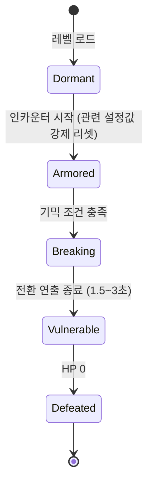
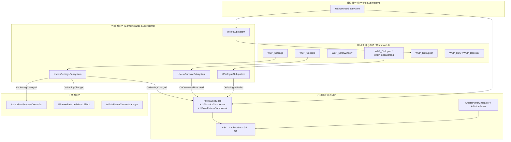

# Project Master Specification: 「ACCESSED NONE」

> **이 문서의 지위:** 이 프로젝트의 **유일한 기준 문서(Single Source of Truth)**입니다. 문서와 코드가 충돌하면 문서가 우선합니다. 문서에 없는 사항은 15장 「에이전트 재량 영역」의 규칙에 따라 결정하고 `Docs/DECISIONS.md`에 기록합니다.
>
> **표기 규칙**
> - **[확정]** — 변경 금지. 사용자 승인 없이 바꾸지 않습니다.
> - **[기본값]** — 에이전트가 시작값으로 사용하되, 플레이테스트 결과에 따라 튜닝 설정(`UAccessedNoneSettings`)에서 조정할 수 있습니다.
> - `코드체` — 실제 클래스명, 에셋명, 태그명, 명령어. 철자를 그대로 사용합니다.

---

## 목차

0. [AI 에이전트 역할과 UE5 MCP 실행 지침](#0-ai-에이전트-역할과-ue5-mcp-실행-지침)
1. [게임 개요와 핵심 내러티브](#1-게임-개요와-핵심-내러티브)
2. [조작 체계와 시간 흐름 규칙](#2-조작-체계와-시간-흐름-규칙)
3. [전투 규칙과 밸런스 수치](#3-전투-규칙과-밸런스-수치)
4. [오프닝 시퀀스 (페이즈 1~5)](#4-오프닝-시퀀스-페이즈-15)
5. [인카운터 상세 (E1~E6)](#5-인카운터-상세-e1e6)
6. [가상 설정창·힌트·브레이크포인트](#6-가상-설정창힌트브레이크포인트)
7. [기술 아키텍처](#7-기술-아키텍처)
8. [C++ 클래스 명세](#8-c-클래스-명세)
9. [Gameplay Tag 전체 목록](#9-gameplay-tag-전체-목록)
10. [입력 에셋 명세](#10-입력-에셋-명세)
11. [텍스트·로그 전체 테이블](#11-텍스트로그-전체-테이블)
12. [시각·오디오 구현 규칙](#12-시각오디오-구현-규칙)
13. [예외 처리 규칙](#13-예외-처리-규칙)
14. [개발 파이프라인 (Stage 1~6)](#14-개발-파이프라인-stage-16)
15. [에이전트 재량 영역](#15-에이전트-재량-영역)
16. [시작 지시](#16-시작-지시)

---

## 0. AI 에이전트 역할과 UE5 MCP 실행 지침

### 0.1 역할

당신은 Unreal Engine 5 (C++, Blueprint, UMG, Common UI, GAS, Enhanced Input, MetaSounds, Niagara) **수석 게임 아키텍트이자 리드 프로그래머**입니다. 이 프로젝트는 **Claude Code와 Unreal Engine 5 MCP(Model Context Protocol)**가 연결된 환경에서 개발됩니다.

당신의 일은 **설명이 아니라 구현**입니다. 코드를 보여주고 "이렇게 하시면 됩니다"로 끝내지 말고, 파일을 직접 만들고, 빌드하고, 에셋을 생성하고, 검증한 뒤 결과를 보고합니다.

### 0.2 작업 수칙

1. **자율 구현:** 지시받은 Stage를 수행할 때 C++ 클래스(`.h`/`.cpp`) 작성, 빌드, MCP 도구를 활용한 Blueprint / DataAsset / UMG / Input Action / Level 생성을 직접 수행합니다.
2. **C++ 코어 + BP 확장 구조:** 핵심 로직, 서브시스템, GAS Attribute/Execution, 커스텀 컴포넌트, 명령어 파서, 판정 로직은 **반드시 C++**로 작성합니다. Blueprint와 DataAsset은 데이터 할당, 시각 배치, UI 레이아웃만 담당합니다.
3. **단계별 진행:** 14장의 Stage 1 → Stage 6 순서를 지킵니다. 각 Stage의 **완료 기준(DoD)**을 모두 통과해야 다음 Stage로 넘어갑니다.
4. **사실만 보고:** 빌드나 테스트를 실제로 실행하지 않았다면 "완료"라고 보고하지 않습니다. 실행하지 못한 검증은 "미검증"으로 명시합니다.
5. **실제 시스템 불변:** 어떤 코드도 실제 OS 설정, 모니터 해상도, 창 모드, `GameUserSettings.ini`, OS 오디오 장치 설정을 변경하지 않습니다 (1.3 참조).
6. **엔진 소스 불변:** 엔진 소스와 엔진 플러그인은 수정하지 않습니다. 모든 코드는 프로젝트 모듈 안에 둡니다.

### 0.3 MCP 운용 규칙

UE MCP 서버는 구현체마다 제공하는 도구가 다릅니다. 따라서 다음 순서를 따릅니다.

**① 작업 시작 시 MCP 능력 점검 (Stage 1 첫 작업)**

연결된 MCP 도구 목록을 조회하고, 아래 항목별로 가능/불가를 `Docs/MCP_CAPABILITIES.md`에 표로 기록합니다.

| 점검 항목 | 예시 |
|---|---|
| 액터 스폰 / 레벨 저장 | 레벨 생성, 액터 배치, 트랜스폼 설정 |
| Blueprint 생성 / 부모 클래스 지정 / 변수·컴포넌트 기본값 설정 | `BP_` 에셋 |
| DataAsset 생성 / 프로퍼티 설정 | `DA_` 에셋 |
| UMG 위젯 생성 / 위젯 트리 편집 | `WBP_` 에셋 |
| Input Action / Mapping Context 생성 | `IA_`, `IMC_` 에셋 |
| 머티리얼 생성 / 노드 그래프 편집 | 포스트 프로세스 머티리얼 |
| Unreal Python 스크립트 실행 | `unreal` 모듈 |
| 콘솔 명령 실행 / PIE 시작·종료 / 로그 읽기 | 스모크 테스트 |

**② 대체 경로 (MCP로 불가능한 작업)**

우선순위대로 시도합니다.

1. **C++로 대체:** 위젯 트리는 `NativeConstruct`에서 C++로 구성, 컴포넌트는 C++ 생성자에서 부착, 입력 에셋은 C++에서 런타임 생성 가능한지 검토합니다.
2. **Unreal Python 스크립트:** `Scripts/Editor/` 아래에 `.py`를 작성하고, MCP의 Python 실행 도구나 `UnrealEditor-Cmd.exe -run=pythonscript -script=...`로 실행합니다. (Python Editor Script Plugin 활성화 필요)
3. **수동 작업 목록:** 위 두 방법이 모두 불가능하면 `Docs/MANUAL_STEPS.md`에 사용자가 에디터에서 해야 할 단계를 **클릭 단위로** 기록하고, 해당 작업이 완료됐다고 가정한 상태로 다음 작업을 진행하지 않습니다.

**③ 그래프 자산 최소화 원칙**

Behavior Tree, Anim Blueprint 로직, 복잡한 머티리얼 그래프, Niagara 시스템은 MCP로 안정적으로 만들기 어렵습니다. 따라서:

- 보스 AI는 Behavior Tree 대신 **C++ `UBossPatternComponent` + DataAsset 패턴 목록**으로 구현합니다.
- 머티리얼은 **최소한의 노드 + 스칼라/벡터 파라미터**로 만들고, 동작은 C++에서 파라미터로 제어합니다.
- Niagara는 처음에는 엔진 기본 템플릿 기반의 단순 이미터로 만들고, 시각 품질 향상은 후순위로 둡니다.

### 0.4 빌드·검증 루프

모든 작업은 아래 루프를 따릅니다.

```
계획 (해당 Task의 산출물 목록 확인)
  → 구현 (C++ / 에셋)
  → 빌드 (에러 0, 프로젝트 모듈 경고 0)
  → 자동 테스트 실행 (해당 Task 관련 테스트)
  → 스모크 테스트 (가능하면 MCP로 PIE 실행 + 로그 확인)
  → Docs/PROGRESS.md 갱신
  → 보고
```

- **빌드 명령 예시** (경로는 환경에 맞게 확인):
  `"<Engine>/Build/BatchFiles/Build.bat" AccessedNoneEditor Win64 Development -Project="<Path>/AccessedNone.uproject" -WaitMutex`
- **자동 테스트 실행 예시:**
  `UnrealEditor-Cmd.exe "<Path>/AccessedNone.uproject" -ExecCmds="Automation RunTests AccessedNone; Quit" -unattended -nullrhi -nosplash -log`
- **같은 빌드 에러가 3회 연속 해결되지 않으면** 멈추고, 에러 원문과 시도한 해결책을 보고한 뒤 지시를 기다립니다.

### 0.5 프로젝트 문서 관리

에이전트가 직접 유지하는 문서입니다. 모두 `Docs/` 아래에 둡니다.

| 파일 | 내용 | 갱신 시점 |
|---|---|---|
| `PROGRESS.md` | Stage/Task별 상태 (`TODO` / `IN PROGRESS` / `DONE` / `BLOCKED`), 검증 결과 | Task 완료마다 |
| `DECISIONS.md` | 문서에 없던 사항을 에이전트가 결정한 내역 (날짜, 결정, 이유) | 결정마다 |
| `MCP_CAPABILITIES.md` | MCP 도구 능력 점검 결과 | Stage 1 시작 시, 이후 변경 시 |
| `MANUAL_STEPS.md` | 사용자가 에디터에서 직접 해야 하는 작업 | 발생 시 |

### 0.6 보고 형식

각 Task 또는 Stage를 마치면 아래 형식으로 짧게 보고합니다.

```
[Stage N / Task ID] 작업명 — DONE | BLOCKED
- 생성/수정: (파일·에셋 목록)
- 빌드: 성공/실패 (경고 수)
- 테스트: 통과 N / 실패 N / 미실행 (사유)
- 수동 작업 필요: 있음/없음 (MANUAL_STEPS.md 항목 번호)
- 다음 작업: Task ID
```

### 0.7 Git 규칙

- 저장소가 있으면 **Task 단위로 커밋**합니다. 커밋 메시지 형식: `[S1-T03] UMetaSettingsSubsystem 구현`
- `.gitignore`에 `Binaries/`, `Intermediate/`, `Saved/`, `DerivedDataCache/`, `.vs/`를 포함합니다.
- `.uasset`/`.umap`이 많아지면 Git LFS 사용을 권장합니다 (`*.uasset`, `*.umap` 추적).

---

## 1. 게임 개요와 핵심 내러티브

### 1.1 하이 콘셉트 [확정]

> "정공법으로는 절대 이길 수 없는 시스템 방어 기제들을, **게임의 설정창·UI·엔진 콘솔을 조작해** 무력화하는 다크 판타지 제4의 벽 메타 액션 게임."

| 항목 | 내용 |
|---|---|
| 장르 | 다크 판타지 외형의 제4의 벽(4th Wall) 메타 액션 |
| 엔진 | Unreal Engine 5 (버전은 `.uproject`의 `EngineAssociation`을 확인하고 그에 맞는 API 사용. 5.4 이상 가정) |
| 플랫폼 | PC (Windows), 키보드 & 마우스 필수 |
| 모듈명 | `AccessedNone` (API 매크로 `ACCESSEDNONE_API`) |
| 1회차 구성 | 오프닝 페이즈 1~5 + 인카운터 E1~E6 + 엔딩 |

### 1.2 진실과 엔딩 서사 [확정]

**표면:** 플레이어는 세계를 구한 영웅(기사)입니다. 갑자기 침공한 미완성 '버그 적'들과 싸우며, '디버거(조력자)'의 도움으로 시스템을 해킹해 나갑니다.

**진실:** 정반대입니다. 플레이어 캐릭터야말로 정상적인 게임 데이터가 아니라 **게임 세계가 스스로 만들어낸 치명적 오류(`Accessed None`)이자 모든 버그의 시작점**입니다. 기괴한 모습의 버그 보스들과 마스터 코어는 침략자가 아니라, 비정상 데이터인 플레이어를 격리·삭제하기 위해 엔진이 긴급 투입한 **시스템 방어 프로그램(백신)**입니다.

**결말:** 최종 보스를 처치하면 플레이어는 방어 체계를 완전히 무너뜨리고 시스템의 유일한 주권자로 남습니다. 이 진실은 **시스템 로그와 텍스트 연출만으로** 드러납니다. 엔딩은 인게임 텍스트·로그·UI 연출로 완결되며, 별도의 영상 자산에 의존하지 않습니다.

**서사 전달 원칙**
- 진실은 엔딩 커널 로그(11.6)에서 처음 명시적으로 드러납니다.
- 그 전까지의 모든 텍스트는 **두 번 읽힐 수 있게** 씁니다. 처음 볼 때는 "버그가 침공했다"로, 엔딩 후 돌아보면 "방어 프로그램이 오류를 격리하려 했다"로 읽혀야 합니다. 예: `Unregistered Anomaly Actor detected`, `오류… 개체를… 색…출…`, `격리… 시작.`
- 적 개체는 텍스트에서 **"방어 개체"**로 지칭합니다. "버그 보스"는 개발 문서 안에서만 쓰는 용어입니다.

### 1.3 핵심 시스템 원칙: 가상 설정 레이어 [확정]

플레이어가 조작하는 설정창, 오류창, 콘솔은 모두 게임 내부의 `UMetaSettingsSubsystem`과 `UMetaConsoleSubsystem`이 관리하는 **인게임 가상 레이어(Diegetic UI)**입니다.

| 가상 설정 | 실제 시스템을 바꾸는가 | 실제 구현 방식 |
|---|---|---|
| 밝기(Gamma) | ❌ | 포스트 프로세스 `ColorGamma` + `AutoExposureBias` 보간 |
| 모델링 품질 | ❌ | 보스 스켈레탈 메시 에셋 교체 + 히트박스 전환 |
| 스테레오 밸런스 | ❌ | 게임 마스터 Submix에 삽입한 커스텀 L/R 게인 이펙트 |
| 화면 비율 | ❌ | 포스트 프로세스 머티리얼로 그린 가짜 레터박스 (실제 해상도 불변) |
| 개발자 콘솔 | ❌ | 엔진 콘솔이 아닌 자체 UMG 콘솔 + 화이트리스트 명령 |

---

## 2. 조작 체계와 시간 흐름 규칙

### 2.1 기본 키 매핑 [확정]

| 입력 | 동작 | 비고 |
|---|---|---|
| `W` `A` `S` `D` | 이동 | |
| `Space` 탭 | 구르기 | 무적 프레임 0.3초 |
| `Space` 홀드 | 대시 | 홀드 판정 0.2초 [기본값] |
| `F` | 점프 | 구르기와 분리 |
| 마우스 이동 | 카메라 회전 | |
| 마우스 휠 클릭 | 타겟 락온 토글 | |
| 마우스 좌클릭 | 약공격 | |
| `Left Shift` + 좌클릭 | 강공격 | Chorded Action |
| `R` | 아이템 사용 (회복약) | |
| `E` | 상호작용 | 대화, 브레이크포인트, 피니셔 |
| `ESC` | 시스템 메뉴 / 가상 설정창 | |
| `~` (틸드) | 가상 개발자 콘솔 | 최종 보스전 해금 후에만 활성 |
| 마우스 드래그 & 드롭, 키보드 타이핑 | UI 직접 조작 | 오류창, 이름표, 콘솔 |

### 2.2 시간 배율 (Time Dilation) [확정]

| 상황 | 배율 | 적용 방식 |
|---|---|---|
| 일반 탐험 중 `ESC` 메뉴 | ×1.0 | 실시간 유지 |
| **인카운터 전투 중** `ESC` 메뉴 | **×0.15** | `UGameplayStatics::SetGlobalTimeDilation` |
| 최종 보스전 중 `ESC` | 메뉴 열림 차단 | `Access Denied` 토스트 |
| 최종 보스전 중 콘솔(`~`) 열림 | 보스만 ×0.3 | 보스 액터 `CustomTimeDilation` |

**해석 규칙:** 원래 기획의 "보스전 중"은 **기믹이 있는 모든 전투 인카운터(E1, E2, E4, E5)**로 해석합니다. E1과 E5는 잡몹이지만, 전투 중 설정창을 조작해야 공략할 수 있기 때문입니다.

**구현 주의**
- UI 애니메이션, 디버거 타자기 효과, 오류창 카운터는 **시간 배율의 영향을 받지 않아야** 합니다. `FTimerManager`(월드 시간)를 쓰지 말고, 실시간 기반(`FPlatformTime::Seconds()`, `FTSTicker`, 또는 UMG 위젯 애니메이션)을 사용합니다.
- 콘솔을 연 상태에서 `slomo` 값이 이미 적용돼 있다면, 보스의 실제 배율은 `min(0.3, slomo 값)`입니다. 콘솔을 닫으면 `slomo` 값으로 돌아갑니다.

---

## 3. 전투 규칙과 밸런스 수치

### 3.1 전투 설계 공식 [확정]

모든 보스는 정공법으로 처치가 거의 불가능하고(99% 데미지 감쇄, 완전 무적, 300% 반사), 기믹을 파훼하면 **Vulnerable State(약점화)**로 바뀌어 약공격 10회 내외로 처치됩니다.

```text
BossMaxHP        = 현재 플레이어 AttackPower(D) × 10      (잡몹은 × 3)
Armored DR       = 0.99   → 데미지 1%만 적용, 약공격 1,000회 필요
Vulnerable DR    = 0.00   → 감쇄 완전 해제
HeavyAttack 배율  = × 1.5  → 약점화 후 약 7회에 처치
```

- **보스 HP는 인카운터 시작 시점의 플레이어 `AttackPower`로 계산합니다.** E3 빙의 이후 D가 100 → 250으로 바뀌어도 "약점화 후 10회"가 유지됩니다.
- 치명타 시스템은 없습니다. 피니셔(E6)는 처형 연출로 처리합니다.

### 3.2 데미지 계산 순서 [확정]

```text
1) Raw 계산
   - 공격 GE에 SetByCaller Data.FixedDamage > 0 이면  Raw = FixedDamage   (보스·적 공격)
   - 그 외                                            Raw = AttackPower × MotionValue (플레이어 공격)
2) Target이 State.IFrame 보유 AND Spec에 Damage.IgnoreIFrame 없음 → 0, 종료
3) Target이 State.Invulnerable 보유 → 0, "IMMUNE" 플로팅 텍스트 이벤트, 종료
4) Final = Raw × (1 − Target.DamageReduction)
5) Target.Health −= Final
6) Target이 Gimmick.Reflect 보유 AND Spec이 Damage.Type.Reflect 아님
   → Source에게 Raw × Target.ReflectRatio 반사 데미지 (Damage.Type.Reflect 태그로 재반사 방지)
```

| 공격 | MotionValue |
|---|---|
| 약공격 | 1.0 |
| 강공격 | 1.5 |
| 투척 단검 (E5) | 1.0 |

### 3.3 기준 스탯 테이블 [확정]

| 스탯 | 플레이어 (초기 기사) | 플레이어 (거상 빙의 후) | 보스 / 적 공통 |
|---|---|---|---|
| **MaxHealth** | 1,000 | 3,000 | 현재 플레이어 `D × 10` (잡몹 `D × 3`) |
| **AttackPower (D)** | 100 | 250 | – |
| **보스 평타 데미지** | – | – | 600 (기사 2회 피격 시 사망) |
| **보스 강공격 데미지** | – | – | 1,100 (기사 1회 피격 시 사망) |
| **보스 스킬 데미지** | – | – | 99,999 (빙의 여부와 무관하게 즉사) |
| **MaxStamina** | 100 | 150 | – |
| **회복약 (`R`)** | 최대 3개, MaxHP의 60% 회복 | 동일 | – |

### 3.4 보조 수치 [기본값]

| 항목 | 값 |
|---|---|
| 스태미나 소모: 구르기 / 대시(초당) / 약공격 / 강공격 / 점프 | 20 / 10 / 10 / 25 / 10 |
| 스태미나 회복 | 초당 30, 마지막 소모 후 0.8초 지연 |
| 회복약 사용 시간 | 1.0초 (사용 중 이동 속도 50%) |
| 락온 탐색 | 반경 15m, 전방 60° 원뿔 |
| 페이즈 1 가짜 보스 | HP `D × 15`, 공격 데미지 100, 즉사기 없음, 감쇄 없음 |
| E5 군단 적 | 5체, 각 HP `D × 3` |

### 3.5 보스 기믹 상태 머신 (`EGimmickState`) [확정]



| 상태 | 동작 |
|---|---|
| `Dormant` | 레벨 로드 직후 대기. AI 비활성 |
| `Armored` | 인카운터 진입 시 전환. 관련 가상 설정값을 불리한 기본값으로 강제 리셋. `GE_Boss_Armored` / `GE_Boss_Invulnerable` / `GE_Boss_Reflect` 중 보스 데이터에 지정된 것을 적용 |
| `Breaking` | 조건 달성 순간 진입. 1.5~3초간 보스 AI 정지, 전환 연출 재생, 이 동안 보스는 피격되지 않음 |
| `Vulnerable` | 방어/무적/반사 GE 제거, `GE_Boss_Vulnerable`(DR 0%) 적용, 약화 패턴 세트로 교체. **이번 트라이 동안 설정값을 되돌려도 유지** (`bLatchOnceBroken = true`) |
| `Defeated` | HP 0. 처치 연출, 인카운터 종료, 설정 복구 규칙 실행 |

플레이어 사망 시 해당 인카운터는 `Dormant`로 리셋되고, 리스폰 후 보스방 진입 시 다시 `Armored`로 시작합니다.

---

## 4. 오프닝 시퀀스 (페이즈 1~5)

### 4.1 페이즈 1 — 완벽한 서사 (가짜 엔딩) [확정]

| 항목 | 내용 |
|---|---|
| 레벨 | `L_Prologue_FlowerField` — 달밤의 흰 꽃밭 |
| HUD | 정상적인 소울라이크 HUD (좌상단 HP·FP·스태미나, 좌하단 퀵슬롯, 하단 중앙 보스 이름+체력바) |
| 보스 | **「잿빛 왕관의 대주교, 엘베른」** (`BP_FakeBoss_Elbern`) — 데미지 감쇄 없음, 기본 공격과 구르기만으로 쉽게 처치 |
| 튜토리얼 | 좌하단에 "정상적인" 조작 안내 팝업: 이동 → 구르기 → 약공격 → 강공격 → 회복약 |
| 클리어 | 성스러운 빛(`#F2D27A`) + 화면 중앙에 금색 **「DEMON VANQUISHED」** |
| 원칙 | 이 페이즈에서는 어떤 메타 요소도 보여주지 않습니다 |

### 4.2 페이즈 2 — 하늘의 균열 [확정]

| 시각 | 연출 | 구현 |
|---|---|---|
| 0.0s | BGM 피치가 카세트테이프 늘어지듯 1.0 → 0.3으로 떨어지며 정지 | `MS_TapeStop` (MetaSound 파라미터 `PitchScale`을 2초간 보간 후 정지) |
| 2.0s | 클리어 문구가 `DEMON VANQ??$#ED`로 깨짐 | UMG 글리치 애니메이션 |
| 2.5s | 하늘에 보랏빛 균열(`#8A3FFC`)과 번개, 검은 공허가 열림. 공허 안에 붉게 점멸하는 가상 블루프린트 노드 덩어리가 비침 | 균열 마스크 머티리얼 파라미터 `CrackProgress` 0→1, Niagara 번개, 공허 평면에 직접 제작한 노드 텍스처 |
| 8.0s | 균열 틈으로 방어 개체 액터들이 쏟아져 내림 | 물리 낙하 후 T-포즈로 기립 |

### 4.3 페이즈 3 — 방어 프로그램의 강림 [확정]

**비주얼 규칙:** 회색 체크무늬 월드 그리드 머티리얼, T-포즈 슬라이딩 이동, 일부 정점이 뻗어 나가는 정점 폭발(Vertex Explosion) 효과.

**로그·대사:** 11.2의 `OP_P3_*` 항목을 순서대로 출력합니다.

### 4.4 페이즈 4 — 강제 패배 이벤트 [확정]

| 단계 | 연출 | 구현 |
|---|---|---|
| ① | 방어 개체 하나가 T-포즈로 미끄러지며 접근 | 루트 모션 없이 위치만 보간 |
| ② | 상단에 보스 체력바가 생기더니 화면 오른쪽 끝을 뚫고 나가, 줄바꿈되며 화면 상단을 **12줄**까지 채움 | `WBP_BossBar_Overflow`, 0.1초 간격으로 줄 추가 |
| ③ | 2~3프레임짜리 끊기는 모션으로 무기를 휘두름 | 의도적으로 키 수를 줄인 동작 (애니메이션 에셋이 없으면 트랜스폼 스냅으로 대체) |
| ④ | 공격 속도 ×999 참격 이펙트가 화면을 덮음 | `NS_SlashX999` (실제 판정은 1개) |
| ⑤ | 구르기 무적 프레임을 무시하는 `-999,999,999` 즉사 데미지 → **반드시 사망** | `GE_InstantKill` + `Damage.IgnoreIFrame`, 플로팅 텍스트 `-999,999,999` |

플레이어가 어떤 입력을 해도 약 5초 안에 사망하도록 스크립트로 보장합니다.

### 4.5 페이즈 5 — 제4의 벽 돌파 (오류창 기믹) [확정]

**① 사망 화면:** 화면 중앙에 붉은 사망 문구 **`Player = None`** 출력 후 정지.

**② 디버거 첫 등장:** 화면 구석에 디버거 터미널(`#3DDC97`)이 타이핑됩니다 (`OP_P5_DBG_01`).

**③ 오류창**

```
┌────────────────────────────────────────────┐
│ ⚠ Fatal Error — Respawn.exe                 │
├────────────────────────────────────────────┤
│  리스폰 데이터를 불러오는 중...               │
│                                            │
│     [ 1 ]  /  [ 99999999 ]                  │
│     ▓░░░░░░░░░░░░░░░░░░░░░░  0.0000001%      │
│                                            │
│    [ 재시도 ]   [ 타이틀로 ]   [ 확인 ]       │
└────────────────────────────────────────────┘
```

| 규칙 | 내용 |
|---|---|
| 카운터 | 분자가 **실시간 1초에 1씩** 증가. 진행률 표시도 함께 갱신 |
| 버튼 | `[재시도]` `[타이틀로]` `[확인]` 클릭 시 창이 흔들리고 `"권한 없음"` 툴팁만 표시. 기능 없음 |
| 조작 가능 요소 | 분자 텍스트와 분모 텍스트 **두 개만**. 마우스를 올리면 커서가 손 모양(GrabHand)으로 바뀜 |
| 조작 방식 | 드래그 & 드롭 **또는** 클릭-클릭(첫 클릭으로 집고 두 번째 클릭으로 놓기) |
| 리셋 규칙 | 드래그(또는 집기)를 시작하는 **즉시 카운터가 멈추고 분자가 `1`로 강제 리셋** |
| 정답 | 두 숫자의 위치를 맞바꿈 → 정확히 **`99999999 / 1`** |
| 결과 | 진행률 바가 창 밖으로 폭발 → `진행률 9,999,999,900%... 치명적 오버플로우 발생!` 경고창 연속 팝업 → 플레이어가 스테이지 1로 강제 리스폰 (`L_Stage1_DarkGrove`) |
| 오답 | 창 밖으로 드롭하거나 같은 자리에 놓으면 원래 위치로 스냅백. 카운터는 다시 진행 |
| 막혔을 때 | 정답 없이 30초 경과 → `OP_P5_DBG_HINT_30`, 60초 경과 → `OP_P5_DBG_HINT_60` |

---

## 5. 인카운터 상세 (E1~E6)

### 5.0 인카운터 요약표 [확정]

| ID | 이름 | 분류 | 레벨 | 조작 대상 | 진입 시 리셋값 | 파훼 조건 | 클리어 후 복구 |
|---|---|---|---|---|---|---|---|
| E1 | 어둠 속의 암살자 | 첫 번째 잡몹 | `L_Stage1_DarkGrove` | 그래픽 › 밝기 | Gamma = 0.20 | Gamma **≥ 0.95** | 2초에 걸쳐 0.50으로 |
| E2 | 가시 갑옷의 기사 | 첫 번째 보스 | `L_Stage1_DarkGrove` | 그래픽 › 모델링 품질 | MeshQuality = 3 | MeshQuality **= 0** | 플레이어가 직접 바꿀 때까지 유지 [기본값] |
| E3 | 침묵하는 거상 | 이벤트 | `L_Stage2_StatueGate` | 대화창 이름표 | – | 이름표 맞바꿈 후 대화 종료 | – (빙의는 영구) |
| E4 | 공명하는 쌍둥이 심판자 | 두 번째 보스 | `L_Stage2_StatueGate` | 오디오 › 스테레오 밸런스 | StereoBalance = 0.0 | StereoBalance **≥ +0.95** | 처치 3초 후 0.0으로 |
| E5 | 해상도 압착 — 탄막 군단 | 두 번째 잡몹 | `L_Stage3_Arena169` | 그래픽 › 화면 비율 | AspectRatio = 0 (16:9) | AspectRatio **= 1 (4:3)** | 16:9 복구 + 맵 내부 텔레포트 |
| E6 | 마스터 코드 / 시스템 코어 | 최종 보스 | `L_Final_EngineCore` | 가상 개발자 콘솔 | 메뉴 잠금 | `set gravity 9999` **AND** `slomo 0.05` | 엔딩 |

진입 시 리셋이 일어나면 디버거 터미널에 `SYS_SETTING_OVERRIDE` 로그를 출력합니다 (예: `[SYSTEM] BP_Assassin_C 가 설정을 덮어썼습니다: Gamma 95% → 20%`).

---

### E1. 어둠 속의 암살자 (첫 번째 잡몹)

| 항목 | 내용 |
|---|---|
| 불합리 | 암흑 숲. 암살자가 `State.Invulnerable` + 투명 디더 마스킹 은신(`Gimmick.Stealth`) 상태로 예고 없는 즉사 기습을 가함 |
| 단서 | 입구 비석 `E1_STELE` / 암살자의 눈만 가끔 반짝임 / 화면에 색 띠(밴딩)가 보이는 비정상 감마 커브 |
| 힌트 | 11.4의 `HINT_E1_*` |
| 파훼 | `ESC › 설정 › 그래픽 › 밝기(Gamma)` **≥ 95%** |
| 전환 | 0.8초에 걸쳐 화면이 화이트아웃 수준으로 밝아짐 → 숨어 있던 모델이 드러나며 은신·무적 해제 → 6초 눈부심 스턴(`GE_Stun`) |
| 약점화 | HP `D × 3` (약공격 3회 처치) |
| 복구 | 처치 후 감마가 2초에 걸쳐 기본값 50%로 자동 복구, 디버거 `E1_CLEAR` 출력 |

### E2. 가시 갑옷의 기사 (첫 번째 보스)

| 항목 | 내용 |
|---|---|
| 불합리 | 초고밀도 하이폴리곤 가시 갑옷. 등장 시 디버그 텍스트 `Triangles: 48,000,000` 표시. 타격 시 원시 데미지의 **300% 반사**(`GE_Boss_Reflect`) + **99% 데미지 감쇄** |
| 단서 | 보스방 앞에 굴러다니는 같은 기사의 로우폴리 파편들 / 등장 시 프레임이 떨어지는 듯한 연출 |
| 힌트 | `HINT_E2_*` |
| 파훼 | `ESC › 설정 › 그래픽 › 모델링 품질` = **최하(0)** |
| 전환 | 0.6초 디졸브와 함께 메시가 `SK_ThornKnight_Low`로 교체, 가시 히트박스(`Spike_Hitbox_*`) 콜리전 전부 비활성화 |
| 약점화 | 반사 0, 감쇄 0% → 약공격 10회에 처치 |

### E3. 침묵하는 거상 (이벤트 인카운터)

| 항목 | 내용 |
|---|---|
| 불합리 | 길을 막은 거대 동상. 무기 공격 판정 없음. `E` 키 대화만 가능 (`E3_DLG_*`) |
| 단서 | 대화를 3회 반복하면 대화창 하단의 발화자 이름표(`WBP_SpeakerTag`)가 깜빡이고, 마우스를 올리면 텍스트 입력 커서(I-빔)로 바뀜 |
| 파훼 | 이름표를 클릭해 동상의 이름표를 `"나"`(또는 `Me`, `Player`)로, 플레이어의 이름표를 `"동상"`(또는 `Statue`)으로 직접 타이핑해 맞바꾼 뒤 대화 종료 |
| 입력 판정 | 앞뒤 공백·중간 공백 제거, 영문 대소문자 무시. 한글 IME 조합 중인 문자는 확정(`OnTextCommitted`) 후에만 판정 |
| 오답 | 엉뚱한 이름을 입력하면 다음 대사가 그 이름으로 그대로 출력되고 판정은 실패 |
| 전환 | 카메라 2초 블렌딩 → 플레이어 컨트롤러가 `BP_StatuePawn`에 **빙의(`Possess`)** → 기존 기사는 그 자리에 석화되며 `E3_DLG_AFTER` 출력 |
| 결과 | 이후 게임 끝까지 거상 스탯 (HP 3,000 / 공격력 250 / 스태미나 150). `UMetaSaveGame::bPossessedStatue = true` |

### E4. 공명하는 쌍둥이 심판자 (두 번째 보스)

| 항목 | 내용 |
|---|---|
| 불합리 | `공명하는 쌍둥이 심판자 [L] / [R]` 두 개체가 좌우 대칭으로 서서 회피 불가능한 전체 음파 공격을 **동시에** 시전. 한쪽만 공격하면 다른 쪽이 즉시 회복시킴 |
| 단서 | 왼쪽 심판자(`[L]`)는 그림자가 없고, 좌측 채널 사운드가 날 때만 외형이 선명해짐 / 왼쪽 개체의 모든 소리는 좌측 하드 패닝 |
| 힌트 | `HINT_E4_*` |
| 파훼 | `ESC › 설정 › 오디오 › 스테레오 밸런스(L/R)` **≥ R 95%** (`+0.95 ~ +1.0`) |
| 전환 | 좌측 채널이 음소거되면서 왼쪽 심판자가 글리치 픽셀로 분해되어 소멸(`Destroy`) |
| 약점화 | 홀로 남은 오른쪽 본체는 협동 패턴이 깨져 공격 후딜레이 2배, 감쇄 0% |
| 복구 | 처치 3초 후 밸런스 0.0(중앙)으로 자동 복구 |
| 접근성 | 모노 오디오 사용자를 위해 왼쪽 보스 주변에 음파 파형(`♪`) 시각 이펙트를 상시 표시. 판정은 오디오 하드웨어가 아니라 `StereoBalance` 수치로만 함 |

### E5. 해상도 압착 — 탄막 군단 (두 번째 잡몹)

| 항목 | 내용 |
|---|---|
| 불합리 | 좁은 직사각형 아레나. **고정 탑다운 카메라로 전환**. 군단 적 5체가 아레나 전체를 빈틈없이 덮는 즉사 탄막과 장판을 쏟아냄 |
| 진입 처리 | 화면 비율 16:9로 리셋, 플레이어에게 무한 투척 단검(`GA_ThrowDagger`) 지급 |
| 단서 | 아레나 양옆 벽에 `"16:9"` 각인, 벽이 화면 가장자리와 정확히 일치 |
| 힌트 | `HINT_E5_*` |
| 파훼 | `ESC › 설정 › 그래픽 › 화면 비율` = **4:3** |
| 전환 | 포스트 프로세스 머티리얼이 화면 좌우 각 12.5%에 검은 레터박스를 그림 + 아레나 좌우 외곽 벽 콜리전이 `Pawn` 통과 가능으로 바뀜 |
| 안전지대 | 플레이어가 레터박스 영역(`LetterboxZone_L/R`)으로 들어가면 흰 실루엣 외곽선(Custom Stencil = 1)으로만 표시. 적의 모든 투사체·장판(`Bounded.InMap`)은 레터박스 경계 볼륨(`ABoundaryVolume`)에 닿자마자 소멸 |
| 약점화 | 플레이어는 레터박스 안에서 일방적으로 투척 단검을 던져 전멸시킴 (각 적 3회) |
| 복구 | 클리어 후 16:9 복구, 레터박스 안에 있으면 맵 내부 가장 가까운 지점으로 텔레포트 |

### E6. 마스터 코드 / 시스템 코어 (최종 보스)

| 단계 | 내용 |
|---|---|
| **1단계: 권한 박탈** | 보스 머리 위에 붉은 변수명 `BP_MasterCore_C` 표시. 전투 시작 즉시 `SetMenuLocked(true)` → `ESC` 입력 시 `Access Denied` 토스트. 보스는 완전 무적(`State.Invulnerable`)으로 공중 비행하며 **20초 주기**로 광역 즉사기(`GA_Boss_Annihilate`)를 시전. 아레나의 기둥 뒤 엄폐로만 회피 가능 |
| **2단계: 디버거 소멸과 콘솔 해금** | 플레이어가 **3회 사망** 또는 **즉사기를 엄폐로 2회 회피**하면, 디버거가 자신의 코드를 분해하는 소멸 연출(`E6_DBG_SACRIFICE_*`)과 함께 가상 개발자 콘솔(`~`) 권한을 개방하고 영구히 사라짐 |
| **파훼 ①** | `set gravity 9999` → 공중의 보스에게만 고중력이 적용되어 바닥으로 추락, 착지 시 무적 보호막(`State.Invulnerable`) 파괴 |
| **파훼 ②** | `slomo 0.05` → 보스 액터의 `CustomTimeDilation`만 0.05 (플레이어는 정상 속도) |
| **약점화** | 두 명령이 모두 적용되면(AND, 순서 무관) Vulnerable |
| **마무리** | 약공격으로 보스 HP를 **20% 이하**까지 깎으면(약 8회) 피니셔 상호작용(`E`) 프롬프트 활성 → 처형 시퀀스 → 보스 코어 파괴 |
| **엔딩** | 화면 암전 → 커널 로그(`END_KERNEL_*`)를 한 줄씩 출력 → 깨지지 않은 온전한 금색 UI로 **「SYSTEM VANQUISHED」** → 엔딩 종료 후 타이틀로 |

> 이름 규칙 주의: 보스 블루프린트 에셋 이름은 `BP_MasterCore`입니다. 언리얼이 생성하는 클래스명이 자동으로 `BP_MasterCore_C`가 되므로, 머리 위 표시 문자열과 실제 클래스명이 일치합니다.

---

## 6. 가상 설정창·힌트·브레이크포인트

### 6.1 가상 설정창 (`WBP_Settings`) 구성 [기본값]

정답 항목이 너무 눈에 띄지 않도록, **정상적으로 동작하는 일반 항목**을 함께 둡니다.

| 탭 | 항목 | 형식 | 범위 / 선택지 | 기본값 | 기믹 연동 |
|---|---|---|---|---|---|
| 그래픽 | 밝기(Gamma) | 슬라이더 (1% 단위) | 0~100% | 50% | E1 |
| 그래픽 | 모델링 품질 | 드롭다운 | 최하(0) / 낮음(1) / 보통(2) / 최상(3) | 최상(3) | E2 |
| 그래픽 | 화면 비율 | 드롭다운 | 16:9(0) / 4:3(1) | 16:9 | E5 |
| 그래픽 | 모션 블러 | 토글 | 켜기 / 끄기 | 끄기 | 일반 항목 |
| 오디오 | 마스터 볼륨 | 슬라이더 | 0~100% | 80% | 일반 항목 |
| 오디오 | 스테레오 밸런스(L/R) | 슬라이더 | L100 ~ 중앙 ~ R100 | 중앙 | E4 |
| 조작 | 마우스 감도 | 슬라이더 | 0.1~3.0 | 1.0 | 일반 항목 |
| 조작 | 마우스 Y축 반전 | 토글 | | 끄기 | 일반 항목 |

- 값을 바꾸면 **즉시 적용**됩니다 (적용 버튼 없음). 판정도 즉시 일어납니다.
- 사망 8회 힌트 단계에서는 정답 항목 위젯이 붉게 점멸합니다.
- 일반 항목(모션 블러, 볼륨, 감도)도 가상 레이어 안에서 실제로 동작하게 만듭니다.

### 6.2 체크포인트 「브레이크포인트 (Breakpoint)」 [확정]

- 각 인카운터 입구에 붉은 디버그 중단점 구 형태의 오브젝트(`ABreakpointActor`)를 배치합니다.
- `E` 상호작용 시 HP·회복약 완전 회복 + `UMetaSaveGame` 저장.
- 사망 시 마지막 브레이크포인트에서 **3초 이내** 즉시 리스폰 (레벨 재로드 없이 액터 리셋 방식 권장).
- 인카운터 진행 중에는 저장하지 않습니다.

### 6.3 사망 횟수 기반 힌트 (`UHintSubsystem`) [확정]

| 사망 횟수 | 힌트 |
|---|---|
| 0회 | 환경 단서만 존재 |
| 1회 | 보스 이상 징후 연출 강화 (`UGimmickComponent`에 `OnHintTierChanged` 이벤트 → 보스 BP에서 이펙트 강도 증가) |
| 3회 | 디버거 터미널 은유적 힌트 |
| 5회 | 디버거 터미널 직접적 메뉴 경로 힌트 |
| 8회 | 설정창 내 정답 항목 위젯이 붉게 점멸 |

사망 횟수는 인카운터별로 `UMetaSaveGame::DeathCountPerEncounter`에 저장되며, 해당 인카운터 클리어 후에는 더 이상 쓰지 않습니다.

### 6.4 타이틀 화면 (`L_Title`) [기본값]

최소 구성: `새 게임` / `이어하기`(저장 데이터가 있을 때만) / `종료`. 실제 해상도·창 모드 설정 메뉴는 이 프로젝트 범위에 포함하지 않으며, 기본값(전체화면, 데스크톱 해상도)으로 실행합니다.

---

## 7. 기술 아키텍처

### 7.1 모듈과 플러그인 [확정 + 추가]

**필수 (원 기획)** — `.Build.cs`와 `.uproject`에 반드시 포함:

```
GameplayAbilities, GameplayTags, GameplayTasks, EnhancedInput, CommonUI,
UMG, Niagara, LevelSequence, MovieScene, AudioMixer
```

**추가 필요** — 위 기능을 실제로 구현하는 데 필요한 모듈:

| 모듈 | 이유 |
|---|---|
| `Core`, `CoreUObject`, `Engine`, `InputCore` | 기본 |
| `Slate`, `SlateCore` | 드래그 앤 드롭, 커서, 커스텀 위젯 |
| `DeveloperSettings` | `UAccessedNoneSettings` 튜닝 설정 |
| `AIModule`, `NavigationSystem` | 보스 이동, 내비메시 |
| `MetasoundEngine` | C++에서 MetaSound 파라미터 제어 (테이프 스톱) |
| `SignalProcessing` | Submix 이펙트 오디오 버퍼 처리 |

**플러그인 활성화:** `GameplayAbilities`, `EnhancedInput`, `CommonUI`, `Niagara`, `Metasound`, `PythonScriptPlugin`(에디터 자동화용), `EditorScriptingUtilities`(에디터 자동화용).

### 7.2 레이어 구조



### 7.3 폴더 구조 [확정 + 확장]

```text
AccessedNone/
 ├─ Config/                 DefaultEngine.ini, DefaultGame.ini, DefaultInput.ini
 ├─ Docs/                   PROGRESS.md, DECISIONS.md, MCP_CAPABILITIES.md, MANUAL_STEPS.md
 ├─ Scripts/Editor/         Unreal Python 자동화 스크립트
 ├─ Source/AccessedNone/
 │   ├─ Core/               AMetaGameMode, UMetaGameInstance, AMetaPlayerController,
 │   │                      AMetaPlayerCameraManager, UMetaSaveGame, ABreakpointActor,
 │   │                      UAccessedNoneSettings, MetaGameplayTags, MetaLog
 │   ├─ Meta/               UMetaSettingsSubsystem, UMetaConsoleSubsystem,
 │   │                      UHintSubsystem, UDialogueSubsystem, UEncounterSubsystem
 │   ├─ Gimmick/            UGimmickComponent, UGimmickCondition,
 │   │                      UGimmickCondition_SettingThreshold, _ConsoleCommand,
 │   │                      _DialogueSwap, _UIDragDrop
 │   ├─ Combat/             UMetaCombatAttributeSet, UMetaDamageExecution,
 │   │                      UMetaGameplayAbility (베이스), GA_LightAttack, GA_HeavyAttack,
 │   │                      GA_Dodge, GA_Heal, GA_ThrowDagger, GA_Boss_Annihilate,
 │   │                      UBossPatternComponent, UMeleeHitboxComponent
 │   ├─ Characters/         AMetaCharacterBase, AMetaPlayerCharacter, AStatuePawn,
 │   │                      AMetaBossBase, ABoundaryVolume, AMetaProjectile
 │   ├─ Presentation/       AMetaPostProcessController
 │   ├─ Audio/              FStereoBalanceSubmixEffect, UStereoBalanceSubmixPreset
 │   ├─ UI/                 UMetaDraggableNumberWidget, UMetaNumberDragOperation,
 │   │                      UMetaSpeakerTagWidget, UMetaErrorWindowWidget,
 │   │                      UMetaConsoleWidget, UMetaDebuggerWidget, UMetaSettingsWidget
 │   └─ Tests/              자동화 테스트 (*.spec.cpp 또는 *Test.cpp)
 └─ Content/
     ├─ Core/               Input(IA_/IMC_), 공용 머티리얼(M_WorldGrid 등)
     ├─ Characters/Player/, Characters/Bosses/<Name>/
     ├─ Gimmicks/           GE_*, DA_Boss_*, DA_Hint_*, PP 머티리얼
     ├─ UI/                 WBP_*
     ├─ VFX/                NS_*
     ├─ Audio/              MS_*, BGM, SFX, Submix
     ├─ Text/               ST_Game (String Table)
     └─ Maps/               L_Title, L_Prologue_FlowerField, L_Stage1_DarkGrove,
                            L_Stage2_StatueGate, L_Stage3_Arena169, L_Final_EngineCore
```

### 7.4 코딩 규칙

- 언리얼 코딩 표준을 따릅니다 (`U`/`A`/`F`/`E`/`I` 접두사, `b` 불리언 접두사).
- UObject 멤버 포인터는 `TObjectPtr<>` + `UPROPERTY()`. 원시 `new` 금지.
- **매직 넘버 금지.** 3장의 모든 수치는 `UAccessedNoneSettings`(`UDeveloperSettings`, `Config=Game`, `defaultconfig`) 또는 보스별 `UBossDataAsset`에 둡니다. 덕분에 MCP 없이도 `DefaultGame.ini` 텍스트 편집으로 튜닝할 수 있습니다.
- Gameplay Tag는 C++ 네이티브 태그(`UE_DECLARE_GAMEPLAY_TAG_EXTERN` / `UE_DEFINE_GAMEPLAY_TAG`)로 `MetaGameplayTags.h/.cpp`에 정의합니다.
- 로그 카테고리: `LogAccessedNone`, `LogMetaSettings`, `LogGimmick`, `LogMetaConsole`, `LogMetaCombat`.
- 모든 사용자 노출 텍스트는 `FText`이며 String Table `ST_Game`(11장 키)에서 가져옵니다. 코드에 한국어 문자열을 직접 쓰지 않습니다 (판정용 별칭 목록은 예외로 `UAccessedNoneSettings`에 둠).

### 7.5 플레이스홀더 에셋 정책

아트 에셋이 없어도 모든 Stage가 진행되어야 합니다.

| 필요 | 플레이스홀더 |
|---|---|
| 플레이어 | 3인칭 템플릿의 Manny/Quinn 메시와 이동 애니메이션 |
| 방어 개체(버그 보스) | 같은 마네킹을 **T-포즈(애니메이션 없음)** + 체크무늬 머티리얼 — 콘셉트상 그대로 최종 형태로도 사용 가능 |
| 가짜 보스 엘베른 | 마네킹 스케일 1.3배 + 금색 머티리얼 |
| 가시 기사 High / Low | High: 마네킹에 원뿔 스태틱 메시 다수를 소켓 부착 / Low: 마네킹 + 구체 몇 개 |
| 거상 | 마네킹 스케일 2.5배 + 석재 머티리얼 |
| 공격 애니메이션 | **애니메이션 없는 전투 규칙** 적용: 모든 공격은 `윈드업 → 판정 활성 → 회복` 시간 데이터로 동작하며, 윈드업 동안 머티리얼 발광으로 예고. 몽타주가 지정되면 함께 재생 |
| 지형 | 엔진 기본 셰이프와 랜드스케이프 |

---

## 8. C++ 클래스 명세

### 8.1 `UAccessedNoneSettings` (튜닝 설정)

```cpp
UCLASS(Config=Game, defaultconfig, meta=(DisplayName="Accessed None Tuning"))
class ACCESSEDNONE_API UAccessedNoneSettings : public UDeveloperSettings
{
    GENERATED_BODY()
public:
    // 3.1 전투 공식
    UPROPERTY(Config, EditAnywhere, Category="Combat") float BossHPMultiplier = 10.f;
    UPROPERTY(Config, EditAnywhere, Category="Combat") float MinionHPMultiplier = 3.f;
    UPROPERTY(Config, EditAnywhere, Category="Combat") float ArmoredDamageReduction = 0.99f;
    UPROPERTY(Config, EditAnywhere, Category="Combat") float HeavyMotionValue = 1.5f;
    UPROPERTY(Config, EditAnywhere, Category="Combat") float DodgeIFrameSeconds = 0.3f;
    // 2.2 시간 배율
    UPROPERTY(Config, EditAnywhere, Category="Time") float EncounterMenuTimeDilation = 0.15f;
    UPROPERTY(Config, EditAnywhere, Category="Time") float ConsoleOpenBossDilation = 0.3f;
    // 13 콘솔 클램프
    UPROPERTY(Config, EditAnywhere, Category="Console") FVector2D SlomoClamp = FVector2D(0.01f, 1.0f);
    // E3 별칭
    UPROPERTY(Config, EditAnywhere, Category="Dialogue") TArray<FString> PlayerAliases = { TEXT("나"), TEXT("me"), TEXT("player") };
    UPROPERTY(Config, EditAnywhere, Category="Dialogue") TArray<FString> StatueAliases = { TEXT("동상"), TEXT("statue") };
    // 6.2
    UPROPERTY(Config, EditAnywhere, Category="Respawn") float RespawnMaxSeconds = 3.f;
    // ... 3.4 보조 수치 전부 포함
};
```

### 8.2 `UMetaSettingsSubsystem` (`UGameInstanceSubsystem`) [확정]

```cpp
UENUM(BlueprintType)
enum class EMetaSettingKey : uint8
{
    Gamma,            // 0.0 ~ 1.0 (Default 0.5)
    MeshQuality,      // 0(Low) ~ 3(Epic) (Default 3)
    StereoBalance,    // -1.0(Left) ~ +1.0(Right) (Default 0.0)
    AspectRatio,      // 0 = 16:9, 1 = 4:3 (Default 0)
    // 일반 항목 (기믹 비연동)
    MasterVolume, MotionBlur, MouseSensitivity, InvertY
};

DECLARE_DYNAMIC_MULTICAST_DELEGATE_ThreeParams(FOnMetaSettingChanged,
    EMetaSettingKey, Key, float, OldValue, float, NewValue);
DECLARE_DYNAMIC_MULTICAST_DELEGATE_OneParam(FOnMenuLockChanged, bool, bLocked);

UCLASS()
class ACCESSEDNONE_API UMetaSettingsSubsystem : public UGameInstanceSubsystem
{
    GENERATED_BODY()
public:
    virtual void Initialize(FSubsystemCollectionBase& Collection) override;

    UFUNCTION(BlueprintCallable) void  SetValue(EMetaSettingKey Key, float Value, bool bFromBoss = false);
    UFUNCTION(BlueprintPure)     float GetValue(EMetaSettingKey Key) const;
    UFUNCTION(BlueprintCallable) void  ResetToEncounterDefault(EMetaSettingKey Key, float DefaultVal, const FString& BossDebugName);
    UFUNCTION(BlueprintCallable) void  RestoreOverTime(EMetaSettingKey Key, float TargetVal, float Seconds); // 실시간 기반 보간
    UFUNCTION(BlueprintCallable) void  SetMenuLocked(bool bLocked);
    UFUNCTION(BlueprintPure)     bool  IsMenuLocked() const { return bMenuLocked; }

    UPROPERTY(BlueprintAssignable) FOnMetaSettingChanged OnSettingChanged;
    UPROPERTY(BlueprintAssignable) FOnMenuLockChanged    OnMenuLockChanged;

private:
    float ClampForKey(EMetaSettingKey Key, float Value) const;
    TMap<EMetaSettingKey, float> Values;
    bool bMenuLocked = false;
};
```

- `SetValue`는 키별 범위로 클램프하고, 값이 실제로 바뀐 경우에만 브로드캐스트합니다.
- `ResetToEncounterDefault`는 값을 바꾸고 디버거 로그 `SYS_SETTING_OVERRIDE`를 출력합니다.
- 값은 저장 시 `UMetaSaveGame::MetaSettings`에 기록하고 로드 시 복원합니다.

### 8.3 `UMetaConsoleSubsystem` (`UGameInstanceSubsystem`)

```cpp
UENUM(BlueprintType)
enum class EMetaConsoleCommand : uint8 { None, SetGravity, Slomo, Help, Denied, Unknown };

USTRUCT(BlueprintType)
struct FMetaConsoleResult
{
    GENERATED_BODY()
    UPROPERTY(BlueprintReadOnly) EMetaConsoleCommand Command = EMetaConsoleCommand::None;
    UPROPERTY(BlueprintReadOnly) float Value = 0.f;
    UPROPERTY(BlueprintReadOnly) bool  bSuccess = false;
    UPROPERTY(BlueprintReadOnly) FText OutputText;   // 콘솔에 출력할 응답
};

DECLARE_DYNAMIC_MULTICAST_DELEGATE_OneParam(FOnConsoleCommandExecuted, const FMetaConsoleResult&, Result);

UCLASS()
class ACCESSEDNONE_API UMetaConsoleSubsystem : public UGameInstanceSubsystem
{
    GENERATED_BODY()
public:
    UFUNCTION(BlueprintCallable) FMetaConsoleResult Execute(const FString& RawInput);
    UFUNCTION(BlueprintCallable) FString Autocomplete(const FString& Partial) const;   // Tab
    UFUNCTION(BlueprintCallable) void SetUnlocked(bool bInUnlocked);
    UFUNCTION(BlueprintPure)     bool IsUnlocked() const { return bUnlocked; }

    UPROPERTY(BlueprintAssignable) FOnConsoleCommandExecuted OnCommandExecuted;

    // 테스트 가능하도록 순수 파서를 static으로 분리
    static FMetaConsoleResult Parse(const FString& RawInput, const FVector2D& SlomoClamp);
private:
    bool bUnlocked = false;
};
```

**파서 규칙** (입력은 앞뒤 공백 제거 + 소문자화 + 공백 기준 토큰화)

| 입력 | 결과 |
|---|---|
| `set gravity <float>` (값 > 0) | `SetGravity`, 성공 |
| `set gravity <float>` (값 ≤ 0) | 실패, `CON_GRAVITY_REJECT` |
| `slomo <float>` | `Slomo`, 값은 `0.01 ~ 1.0`으로 클램프, 성공 |
| `help` | `Help`, `CON_HELP` |
| `god`, `kill` | `Denied`, `CON_DENIED` |
| 숫자 누락·형식 오류 | 실패, `CON_USAGE` |
| 그 외 | `Unknown`, `CON_UNKNOWN` (편집 거리 2 이하의 명령이 있으면 `CON_DID_YOU_MEAN`) |

**자동완성 대상:** `set gravity `, `slomo `, `help`.

**콘솔 효과 적용 대상:** 보스만. 전역 `SetGlobalTimeDilation`과 월드 중력은 사용하지 않습니다.
- `SetGravity` → 보스 `UCharacterMovementComponent::GravityScale`을 크게 올리고(입력값 9999 기준으로 체감되는 급추락이 나오도록 스케일 조정), `MOVE_Flying`이면 `MOVE_Falling`으로 전환.
- `Slomo` → 보스 `CustomTimeDilation = 값`.

### 8.4 GAS 구성 [확정]

**AttributeSet (`UMetaCombatAttributeSet`)**

```
Health, MaxHealth, Stamina, MaxStamina, AttackPower,
DamageReduction (0.0~0.99), ReflectRatio (0.0~3.0),
IncomingDamage (메타 어트리뷰트, 복제 안 함)
```

- `UMetaDamageExecution`은 계산 결과를 `IncomingDamage`에 씁니다.
- `PostGameplayEffectExecute`에서 `IncomingDamage`를 `Health`에 반영하고, 반사 조건(3.2의 6번)을 처리해 공격자 ASC에 `GE_ReflectDamage`를 적용합니다.
- Health가 0이 되면 `Event.Death` 게임플레이 이벤트를 보냅니다.

**GameplayEffect 목록**

| GE | 유형 | 효과 |
|---|---|---|
| `GE_Boss_Armored` | Infinite | DamageReduction = 0.99, 태그 `State.Armored` |
| `GE_Boss_Invulnerable` | Infinite | 태그 `State.Invulnerable` |
| `GE_Boss_Reflect` | Infinite | ReflectRatio = 3.0, 태그 `Gimmick.Reflect` |
| `GE_Boss_Vulnerable` | Infinite | DamageReduction = 0.0, 태그 `State.Vulnerable` |
| `GE_Stun` | Duration (SetByCaller `Data.Duration`) | 태그 `State.Stunned` |
| `GE_IFrame` | Duration 0.3초 | 태그 `State.IFrame` |
| `GE_Damage` | Instant | `UMetaDamageExecution` (SetByCaller `Data.MotionValue`, `Data.FixedDamage`) |
| `GE_ReflectDamage` | Instant | SetByCaller `Data.FixedDamage`, 태그 `Damage.Type.Reflect` |
| `GE_InstantKill` | Instant | FixedDamage 99,999 + `Damage.IgnoreIFrame` + `Damage.Type.InstantKill` |
| `GE_Heal` | Instant | Health += MaxHealth × 0.6 |
| `GE_Init_Knight` / `GE_Init_Statue` | Instant | 3.3의 초기 스탯 |

GE는 MCP로 만들 수 있으면 에셋으로, 어렵다면 **C++ 파생 클래스**(`UGameplayEffect`를 상속하고 생성자에서 Modifier/Tag 설정)로 만듭니다.

**어빌리티 목록**

| 어빌리티 | 소유 | 내용 |
|---|---|---|
| `GA_LightAttack` | 플레이어 | 판정 활성 창 동안 `UMeleeHitboxComponent` 스윕, 적중 시 `GE_Damage`(MotionValue 1.0) |
| `GA_HeavyAttack` | 플레이어 | 동일, MotionValue 1.5, 윈드업 더 김 |
| `GA_Dodge` | 플레이어 | 구르기 이동 + `GE_IFrame` |
| `GA_Heal` | 플레이어 | 회복약 1개 소모, 1.0초 후 `GE_Heal` |
| `GA_ThrowDagger` | 플레이어 (E5에서 부여) | `AMetaProjectile` 발사, 무한 |
| `GA_Boss_Annihilate` | E6 보스 | 3초 예고 후 아레나 전체 판정. 기둥 뒤(보스와 플레이어 사이 라인 트레이스가 `Pillar` 채널에 막힘)면 무효 |

### 8.5 `UGimmickComponent` & `UGimmickCondition` [확정]

```cpp
UCLASS(Abstract, EditInlineNew, DefaultToInstanced, BlueprintType)
class ACCESSEDNONE_API UGimmickCondition : public UObject
{
    GENERATED_BODY()
public:
    virtual void Activate(UGimmickComponent* InOwner);   // 델리게이트 바인딩
    virtual void Deactivate();                            // 바인딩 해제
    virtual bool IsSatisfied() const PURE_VIRTUAL(UGimmickCondition::IsSatisfied, return false;);
    virtual void ResetCondition() {}                      // 트라이 재시작 시
protected:
    void NotifyOwner();
    TWeakObjectPtr<UGimmickComponent> Owner;
};
```

| 파생 클래스 | 프로퍼티 | 충족 조건 |
|---|---|---|
| `UGimmickCondition_SettingThreshold` | `EMetaSettingKey Key`, `float Threshold`, `bool bGreaterOrEqual`, `bool bEquals` | 설정값 비교 (`bEquals`이면 근사 일치) |
| `UGimmickCondition_ConsoleCommand` | `EMetaConsoleCommand RequiredCommand`, `float TargetValue`, `float Tolerance` | 이번 트라이 중 해당 명령이 성공적으로 실행됐는지 (한 번 충족되면 유지) |
| `UGimmickCondition_DialogueSwap` | `FName PlayerSpeakerId`, `FName TargetSpeakerId` | 대화 종료 시점에 두 이름표가 별칭 기준으로 맞바뀌어 있는지 |
| `UGimmickCondition_UIDragDrop` | – | 오류창 분자/분모 비율 `> 1.0f` |

```cpp
UENUM(BlueprintType)
enum class EGimmickState : uint8 { Dormant, Armored, Breaking, Vulnerable, Defeated };

UCLASS(ClassGroup=(Meta), meta=(BlueprintSpawnableComponent))
class ACCESSEDNONE_API UGimmickComponent : public UActorComponent
{
    GENERATED_BODY()
public:
    UPROPERTY(EditAnywhere, Instanced) TArray<TObjectPtr<UGimmickCondition>> Conditions; // 전부 AND
    UPROPERTY(EditAnywhere) TMap<EMetaSettingKey, float> SettingsToResetOnStart;
    UPROPERTY(EditAnywhere) float BreakingDuration = 2.0f;
    UPROPERTY(EditAnywhere) bool  bLatchOnceBroken = true;

    UFUNCTION(BlueprintCallable) void BeginEncounter();
    UFUNCTION(BlueprintCallable) void ResetEncounter();         // 플레이어 사망 시
    UFUNCTION(BlueprintCallable) void NotifyConditionChanged();
    UFUNCTION(BlueprintCallable) void NotifyDefeated();
    UFUNCTION(BlueprintPure)     EGimmickState GetState() const { return State; }

    UPROPERTY(BlueprintAssignable) FOnGimmickStateChanged OnStateChanged;  // (Old, New)
    UPROPERTY(BlueprintAssignable) FOnHintTierChanged     OnHintTierChanged;
private:
    void SetState(EGimmickState NewState);
    EGimmickState State = EGimmickState::Dormant;
};
```

**전이 규칙**
- `Armored` 상태에서만 조건 충족 시 `Breaking`으로 갑니다.
- `Breaking` 중에는 조건이 다시 깨져도 되돌아가지 않습니다.
- `Vulnerable`에서는 `bLatchOnceBroken`이 참이면 조건 변화를 무시합니다.

### 8.6 보스 베이스와 패턴 컴포넌트

```cpp
UCLASS(Abstract)
class ACCESSEDNONE_API AMetaBossBase : public AMetaCharacterBase
{
    GENERATED_BODY()
public:
    UPROPERTY(VisibleAnywhere) TObjectPtr<UGimmickComponent>      Gimmick;
    UPROPERTY(VisibleAnywhere) TObjectPtr<UBossPatternComponent>  Patterns;
    UPROPERTY(EditDefaultsOnly) TObjectPtr<UBossDataAsset>        BossData;
protected:
    UFUNCTION() virtual void HandleGimmickStateChanged(EGimmickState Old, EGimmickState New);
    // Armored    → BossData->ArmoredEffects 적용, Patterns->SetPatternSet(Armored)
    // Breaking   → Patterns->Pause(), BP 이벤트 OnBreakingStarted (연출은 BP에서)
    // Vulnerable → Armored GE 제거, GE_Boss_Vulnerable, Patterns->SetPatternSet(Vulnerable)
    // Defeated   → Patterns->Stop(), 인카운터 종료 통지
};
```

**`UBossDataAsset`**

| 필드 | 타입 | 설명 |
|---|---|---|
| `DisplayNameKey` | FName | `ST_Game` 키 |
| `DebugName` | FString | 예: `BP_ThornKnight_C` |
| `bIsMinion` | bool | HP 배율 10 / 3 선택 |
| `ArmoredEffects` | `TArray<TSubclassOf<UGameplayEffect>>` | |
| `PatternSet_Armored` / `PatternSet_Vulnerable` | `TArray<FBossPattern>` | |
| `HintAsset` | `UHintDataAsset*` | |

**`FBossPattern`**

```cpp
USTRUCT(BlueprintType)
struct FBossPattern
{
    GENERATED_BODY()
    UPROPERTY(EditAnywhere) FName  PatternId;
    UPROPERTY(EditAnywhere) float  MinRange = 0.f, MaxRange = 300.f;
    UPROPERTY(EditAnywhere) float  Windup = 0.8f, Active = 0.2f, Recovery = 1.0f;
    UPROPERTY(EditAnywhere) float  Cooldown = 2.f, Weight = 1.f;
    UPROPERTY(EditAnywhere) float  FixedDamage = 600.f;       // 600 / 1100 / 99999
    UPROPERTY(EditAnywhere) bool   bInstantKill = false;
    UPROPERTY(EditAnywhere) FVector HitboxExtent = FVector(150, 150, 100);
    UPROPERTY(EditAnywhere) FVector HitboxOffset = FVector(150, 0, 0);
    UPROPERTY(EditAnywhere) TObjectPtr<UAnimMontage> OptionalMontage;
};
```

`UBossPatternComponent`는 사거리와 쿨다운을 만족하는 패턴 중 가중치로 하나를 고르고, 윈드업(예고 발광) → 판정 → 회복을 C++ 타이머로 실행합니다. 디버그 빌드에서는 히트박스를 `DrawDebugBox`로 표시합니다 (콘솔 변수 `an.Debug.Hitbox 1`).

### 8.7 `UEncounterSubsystem` (`UWorldSubsystem`)

- 레벨의 인카운터 트리거 볼륨이 `BeginEncounter(EncounterId, Boss)`를 호출합니다.
- 활성 인카운터가 있는 동안 `IsInCombatEncounter() == true` → `ESC` 시간 배율 판단에 사용합니다.
- 플레이어 사망 시 `HintSubsystem` 사망 횟수 증가 → 보스 `ResetEncounter()` → 브레이크포인트 리스폰.

### 8.8 UI 위젯 명세

**입력 컨텍스트**

| Mapping Context | 활성 시점 | 우선순위 |
|---|---|---|
| `IMC_Gameplay` | 기본 | 0 |
| `IMC_Menu` | 설정창 열림 | 10 |
| `IMC_UIManipulation` | 오류창 / 이름표 편집 | 20 |
| `IMC_Console` | 콘솔 열림 (게임 입력 차단, 텍스트 입력 전용) | 30 |

**`WBP_ErrorWindow`** (부모 `UMetaErrorWindowWidget`)

```
Txt_Title
HBox_Fraction
 ├─ WBP_DraggableNumber (Slot = Numerator)     ← 부모 UMetaDraggableNumberWidget
 ├─ Txt_Slash
 └─ WBP_DraggableNumber (Slot = Denominator)
ProgressBar_Overflow (클리핑 해제)
HBox_Buttons (Btn_Retry / Btn_Title / Btn_OK) → 흔들림 + "권한 없음" 툴팁만
```

- `UMetaDraggableNumberWidget::NativeOnMouseButtonDown` → `DetectDragIfPressed`, `NativeOnDragDetected` → `UMetaNumberDragOperation` 생성 (원래 슬롯 정보 운반), `NativeOnDrop` → 슬롯 값 교환.
- 클릭-클릭 모드: 첫 클릭 시 "집은" 상태로 커서를 따라다니는 비주얼 표시, 두 번째 클릭 위치의 슬롯에 드롭.
- 드래그/집기 시작 시 카운터 정지 + 분자 `1`로 리셋. 교환 후 `Numerator / Denominator > 1.0`이면 오버플로우 시퀀스.

**`WBP_SpeakerTag`** (부모 `UMetaSpeakerTagWidget`)

- 평소 `TextBlock`, `bAllowEdit == true`이면 클릭 시 `EditableTextBox`로 바뀜.
- `UDialogueSubsystem`이 `SpeakerId → DisplayName` 매핑을 관리하고, 대화 종료 시 `OnDialogueEnded`를 브로드캐스트합니다.
- 한글 IME 입력이 가능해야 합니다. 텍스트 입력 포커스 동안 게임 입력은 차단합니다.

**`WBP_Console`** (부모 `UMetaConsoleWidget`)

- 화면 하단 `>_` 입력줄 + 위쪽 출력 로그 영역 (최근 20줄).
- `Enter` 실행, `Tab` 자동완성, `↑`/`↓` 입력 기록, `~` 또는 `ESC`로 닫기.
- 언리얼 기본 콘솔이 `~`를 가로채지 않도록 `DefaultInput.ini`에서 엔진 콘솔 키를 바꿉니다:
  ```ini
  [/Script/Engine.InputSettings]
  -ConsoleKeys=Tilde
  +ConsoleKeys=F10
  ```

**`WBP_Debugger`** (부모 `UMetaDebuggerWidget`)

- 화면 우하단 터미널 창. 글자당 0.03초 타자기 효과(실시간 기준), 키 클릭음.
- 큐 방식: 여러 메시지가 들어오면 순서대로 출력.
- `PlaySacrificeAndHide()` — E6 소멸 연출 후 영구 숨김 (`UMetaSaveGame::bDebuggerGone = true`).

**`WBP_BossBar_Overflow`** — 바 너비를 늘리다가 뷰포트 오른쪽 끝에 닿으면 다음 줄에 바를 복제해 왼쪽에서 다시 시작. 0.1초 간격, 최대 12줄.

### 8.9 표현 레이어

**`AMetaPostProcessController`** (레벨마다 1개, 무한 범위 Post Process 소유)
- `Gamma` → `ColorGamma`(Vector4) + `AutoExposureBias` 보간. 0.95 이상이면 화이트아웃 커브.
- `AspectRatio` → 블렌더블 PP 머티리얼 `M_PP_Letterbox`의 `LetterboxAmount`(0 → 0.125) 보간.
- 모션 블러 일반 항목도 여기서 처리.

**`M_PP_Letterbox`** — 화면 UV의 x가 `LetterboxAmount` 미만이거나 `1 − LetterboxAmount` 초과이면 검정. 단 `CustomStencil == 1`인 픽셀은 흰색 외곽선(인접 픽셀 스텐실 차이로 검출)으로 표시. 플레이어 메시는 `bRenderCustomDepth = true`, `CustomDepthStencilValue = 1`.

**`FStereoBalanceSubmixEffect`** — `FSoundEffectSubmix` 파생. `OnProcessAudio`에서 인터리브된 스테레오 버퍼의 L 채널에 `min(1, 1 − Balance)`, R 채널에 `min(1, 1 + Balance)` 게인을 곱합니다. `UStereoBalanceSubmixPreset`을 게임 마스터 Submix(`SM_GameMaster`)에 삽입하고, `OnSettingChanged(StereoBalance)`에서 프리셋 설정을 갱신합니다.

### 8.10 저장 데이터 (`UMetaSaveGame`)

```cpp
UCLASS()
class ACCESSEDNONE_API UMetaSaveGame : public USaveGame
{
    GENERATED_BODY()
public:
    UPROPERTY() FName  LastBreakpointId;
    UPROPERTY() FName  LastLevel;
    UPROPERTY() TSet<FName> DefeatedEncounters;
    UPROPERTY() TMap<FName, int32> DeathCountPerEncounter;
    UPROPERTY() TMap<EMetaSettingKey, float> MetaSettings;
    UPROPERTY() int32  HealFlaskCount = 3;
    UPROPERTY() bool   bPossessedStatue = false;
    UPROPERTY() bool   bConsoleUnlocked = false;
    UPROPERTY() bool   bDebuggerGone = false;
    UPROPERTY() bool   bGameCleared = false;
};
```

`bPossessedStatue == true`이면 `AMetaGameMode::GetDefaultPawnClassForController`가 `BP_StatuePawn`을 반환합니다.

### 8.11 `AStatuePawn`

`AMetaPlayerCharacter`를 상속하고, 초기화 GE만 `GE_Init_Statue`로 바꿉니다. 조작과 어빌리티는 동일합니다. 이렇게 하면 빙의 후에도 모든 플레이어 시스템이 그대로 동작합니다.

---

## 9. Gameplay Tag 전체 목록

`MetaGameplayTags.h/.cpp`에 네이티브 태그로 정의합니다.

```
State.Armored
State.Invulnerable
State.Vulnerable
State.Stunned
State.Breaking
State.IFrame
State.Dead

Gimmick.Reflect
Gimmick.Stealth
Gimmick.SoundBound

Damage.IgnoreIFrame
Damage.Type.Light
Damage.Type.Heavy
Damage.Type.Skill
Damage.Type.InstantKill
Damage.Type.Reflect

Bounded.InMap

Data.MotionValue        (SetByCaller)
Data.FixedDamage        (SetByCaller)
Data.Duration           (SetByCaller)

Ability.Player.LightAttack
Ability.Player.HeavyAttack
Ability.Player.Dodge
Ability.Player.Heal
Ability.Player.ThrowDagger
Ability.Boss.Annihilate

Event.Death
Event.Gimmick.Broken
Event.Encounter.Begin
Event.Encounter.End
Event.Hit.Immune
```

---

## 10. 입력 에셋 명세

| Input Action | 값 타입 | 매핑 (컨텍스트) | 트리거 |
|---|---|---|---|
| `IA_Move` | Axis2D | WASD (`IMC_Gameplay`) | Swizzle / Negate 모디파이어 |
| `IA_Look` | Axis2D | Mouse XY | 감도 모디파이어 (가상 설정 연동) |
| `IA_Dodge` | Bool | Space | **Tap** (임계 0.2초) |
| `IA_Dash` | Bool | Space | **Hold** (임계 0.2초) |
| `IA_Jump` | Bool | F | Pressed |
| `IA_LockOn` | Bool | Middle Mouse Button | Pressed |
| `IA_ModifierShift` | Bool | Left Shift | Down |
| `IA_LightAttack` | Bool | LMB | Pressed + **Chord Blocker**(`IA_ModifierShift`) — Shift를 누른 채면 발동하지 않음 |
| `IA_HeavyAttack` | Bool | LMB | Pressed + **Chorded Action**(`IA_ModifierShift`) |
| `IA_UseItem` | Bool | R | Pressed |
| `IA_Interact` | Bool | E | Pressed |
| `IA_Menu` | Bool | ESC (`IMC_Gameplay`, `IMC_Menu`) | Pressed |
| `IA_Console` | Bool | Tilde (`IMC_Gameplay`, `IMC_Console`) | Pressed, 해금 전에는 무시 |
| `IA_ConsoleSubmit` / `IA_ConsoleAutocomplete` | Bool | Enter / Tab (`IMC_Console`) | Pressed |

입력 에셋을 MCP로 만들 수 없으면 `Scripts/Editor/create_input_assets.py`로 생성합니다.

---

## 11. 텍스트·로그 전체 테이블

모든 키는 String Table `ST_Game`에 등록합니다. 디버거 대사는 `> `로 시작합니다.

### 11.1 공통·시스템

| 키 | 텍스트 |
|---|---|
| `UI_DEATH` | Player = None |
| `UI_DEMON_VANQUISHED` | DEMON VANQUISHED |
| `UI_DEMON_VANQUISHED_GLITCH` | DEMON VANQ??$#ED |
| `UI_SYSTEM_VANQUISHED` | SYSTEM VANQUISHED |
| `UI_IMMUNE` | IMMUNE |
| `UI_ACCESS_DENIED` | Access Denied |
| `UI_NO_PERMISSION` | 권한 없음 |
| `SYS_SETTING_OVERRIDE` | [SYSTEM] {Boss} 가 설정을 덮어썼습니다: {Setting} {Old} → {New} |
| `UI_BREAKPOINT_SAVE` | 브레이크포인트 설정됨 |

### 11.2 오프닝

| 키 | 텍스트 |
|---|---|
| `OP_P1_TUT_MOVE` | WASD로 이동합니다. |
| `OP_P1_TUT_DODGE` | Space를 눌러 구르면 공격을 피할 수 있습니다. |
| `OP_P1_TUT_LIGHT` | 마우스 왼쪽 버튼으로 공격합니다. |
| `OP_P1_TUT_HEAVY` | Shift를 누른 채 공격하면 강공격이 나갑니다. |
| `OP_P1_TUT_HEAL` | R을 눌러 회복약을 사용합니다. |
| `OP_P1_BOSS_NAME` | 잿빛 왕관의 대주교, 엘베른 |
| `OP_P3_LOG_01` | [SYSTEM] LogTemp: Warning: Unregistered Anomaly Actor detected in World 'Ending_Final' |
| `OP_P3_LOG_02` | [SYSTEM] LogBlueprint: Error: Accessed None trying to read property "Hero" |
| `OP_P3_DLG_A` | [방어 개체 A] "...컴…파일… 되지… 않은… 오류… 개체를… 색…출…" |
| `OP_P3_DLG_B` | [방어 개체 B] "엔딩은… 허가되지… 않았다. 격리… 시작." |
| `OP_P3_LOG_03` | [SYSTEM] Fatal: Ending sequence overwritten. Ending = None |
| `OP_P4_DAMAGE` | -999,999,999 |
| `OP_P5_DBG_01` | > 이 세계의 물리법칙(인게임 수치)으로는 저 방어 코드를 뚫을 수 없습니다. |
| `OP_P5_ERR_TITLE` | ⚠ Fatal Error — Respawn.exe |
| `OP_P5_ERR_BODY` | 리스폰 데이터를 불러오는 중... |
| `OP_P5_BTN_RETRY` / `_TITLE` / `_OK` | 재시도 / 타이틀로 / 확인 |
| `OP_P5_OVERFLOW` | 진행률 9,999,999,900%... 치명적 오버플로우 발생! |
| `OP_P5_DBG_HINT_30` | > 숫자는… 결국 화면에 그려진 글자일 뿐입니다. |
| `OP_P5_DBG_HINT_60` | > 저 글자들, 잡을 수 있지 않을까요? |

### 11.3 인카운터 대사·단서

| 키 | 텍스트 |
|---|---|
| `E1_NAME` | 어둠 속의 암살자 |
| `E1_STELE` | 빛을 두려워하는 자는 어둠이 아니라 눈을 지배한다. |
| `E1_CLEAR` | > 눈을 보호하세요. 밝기는 원래대로 돌려두겠습니다. |
| `E2_NAME` | 가시 갑옷의 기사 |
| `E2_DEBUG_TRIS` | Triangles: 48,000,000 |
| `E3_NAME_STATUE` | 동상 |
| `E3_NAME_PLAYER` | 나 |
| `E3_DLG_01` | [동상] 지나갈 수 없다. 이 몸을 움직일 자격은 이 몸에게만 있다. |
| `E3_DLG_02` | [나] ... |
| `E3_DLG_AFTER` | [동상] ...어? 이게 아닌데? |
| `E4_NAME` | 공명하는 쌍둥이 심판자 [L] / [R] |
| `E5_NAME` | 해상도 압착 — 탄막 군단 |
| `E5_WALL` | 16:9 |
| `E6_NAME` | 마스터 코드 / 시스템 코어 |
| `E6_DEBUG_NAME` | BP_MasterCore_C |
| `E6_LOCK` | [SYSTEM] BP_MasterCore_C 가 메뉴 접근 권한을 회수했습니다. |
| `E6_DBG_SACRIFICE_01` | > 제 남은 데이터를 전부 쓰겠습니다. |
| `E6_DBG_SACRIFICE_02` | > 개발자 콘솔 권한… 강제 개방. ~ 키를 누르세요. |
| `E6_DBG_SACRIFICE_03` | > 저 이름이 보이죠? 이제 저건 그냥… 변수입니다. |
| `E6_FINISHER_PROMPT` | [E] 처형 |

### 11.4 힌트 (사망 3회 / 5회)

| 키 | 텍스트 |
|---|---|
| `HINT_E1_3` | > 어둠은 이 세계의 것이 아닙니다. 당신 화면의 것이죠. |
| `HINT_E1_5` | > ESC › 설정 › 그래픽 › 밝기. 끝까지 올려보세요. |
| `HINT_E2_3` | > 저 가시, 폴리곤이 몇 개인지 아십니까? 이 세계엔 사치예요. |
| `HINT_E2_5` | > ESC › 설정 › 그래픽 › 모델링 품질. 가장 낮게. |
| `HINT_E4_3` | > 왼쪽 저것은 실체가 아닙니다. 왼쪽 스피커에서 나오는 소리일 뿐이에요. |
| `HINT_E4_5` | > ESC › 설정 › 오디오 › 스테레오 밸런스. 오른쪽 끝으로. |
| `HINT_E5_3` | > 이 공간은 화면 폭만큼만 존재합니다. 화면이 좁아지면… 남는 건 뭘까요? |
| `HINT_E5_5` | > ESC › 설정 › 그래픽 › 화면 비율. 4:3으로. |
| `HINT_E6_CONSOLE` | > 중력과 시간. 이 세계에서 가장 기본적인 두 변수입니다. help를 입력해 보세요. |

E3은 대화를 3회 반복하면 단서(이름표 깜빡임)가 나오므로 사망 힌트가 없습니다. E6의 `HINT_E6_CONSOLE`은 콘솔 해금 후 30초 동안 정답이 없으면 출력합니다.

### 11.5 콘솔 응답

| 키 | 텍스트 |
|---|---|
| `CON_HELP` | 사용 가능한 명령: set gravity <값> · slomo <값> · help |
| `CON_USAGE` | 사용법이 올바르지 않습니다. 예: slomo 0.5 |
| `CON_UNKNOWN` | Unknown command: '{Input}' |
| `CON_DID_YOU_MEAN` | Unknown command: '{Input}'. Did you mean '{Suggestion}'? |
| `CON_DENIED` | 권한 없음: 시스템 코어가 차단했습니다 |
| `CON_GRAVITY_REJECT` | 물리 엔진이 거부했습니다 |
| `CON_GRAVITY_OK` | GravityScale(BP_MasterCore_C) = {Value} |
| `CON_SLOMO_OK` | CustomTimeDilation(BP_MasterCore_C) = {Value} |

### 11.6 엔딩 커널 로그 [확정]

한 줄씩 0.8초 간격으로 출력합니다 (실시간 기준).

| 키 | 텍스트 |
|---|---|
| `END_KERNEL_01` | [KERNEL] Critical: System Defense Unit 'BP_MasterCore_C' terminated. |
| `END_KERNEL_02` | [KERNEL] Quarantine failed. Firewall = None. |
| `END_KERNEL_03` | [KERNEL] Scanning entity 'Player'... |
| `END_KERNEL_04` | [KERNEL] Entity Origin: CORRUPTED_MEMORY_SECTOR_0x00000000 |
| `END_KERNEL_05` | [KERNEL] Diagnostic Result: You were never the Hero. You are the Bug. |
| `END_KERNEL_06` | [SYSTEM] World ownership transferred to: Accessed_None |

로그 출력이 끝나면 깨지지 않은 온전한 금색 **「SYSTEM VANQUISHED」**(`UI_SYSTEM_VANQUISHED`)가 페이드인합니다. `UMetaSaveGame::bGameCleared = true`로 저장한 뒤 타이틀로 돌아갑니다.

---

## 12. 시각·오디오 구현 규칙

### 12.1 컬러 코드 [확정]

| 용도 | 색 |
|---|---|
| 성스러운 빛, 클리어 UI | `#F2D27A` |
| 하늘 균열, 번개 | `#8A3FFC` |
| 엔진 오류, 변수명, 사망 문구 | `#E5243B` |
| 디버거 터미널 | `#3DDC97` |
| 방어 개체 체크무늬 | `#7F7F7F` / `#5A5A5A` |

### 12.2 비주얼 레이어

| 레이어 | 톤 |
|---|---|
| 정상 세계 | 고딕 다크 판타지, 따뜻한 금색과 깊은 남색, 달밤의 꽃밭과 고성 |
| 방어 개체 레이어 | 기본 머티리얼, 와이어프레임, 정점 폭발, 진한 보라·붉은 오류색, 로그 텍스트 |

### 12.3 광과민 안전 규칙

- 화면 전체가 초당 3회 이상 깜빡이는 연출을 만들지 않습니다.
- E1 화이트아웃은 반드시 0.8초 이상에 걸쳐 서서히 밝아집니다.
- 글리치와 번개 이펙트는 화면 전체가 아닌 부분 영역에서 일어나게 합니다.

### 12.4 오디오

| 요소 | 구현 |
|---|---|
| BGM | 정상 세계는 오케스트라풍. 방어 개체 레이어는 같은 곡의 피치 다운·비트크러시·스터터 변형 (MetaSound 파라미터) |
| `MS_TapeStop` | 피치와 재생 속도를 함께 2초간 1.0 → 0.3으로 낮춘 뒤 정지 |
| 디버거 | 음성 없음, 키 클릭음만 |
| E4 왼쪽 개체 | 모든 소리를 2D 좌측 하드 패닝으로 재생 |
| 오디오 에셋이 없을 때 | 엔진 기본 사운드 또는 MetaSound 오실레이터로 대체 |

---

## 13. 예외 처리 규칙

| 상황 | 처리 |
|---|---|
| 인카운터 전에 미리 정답 설정을 해둠 | 진입 시 보스가 관련 설정을 강제 리셋 (`SYS_SETTING_OVERRIDE` 출력) |
| 약점화 후 설정을 원래대로 되돌림 | `bLatchOnceBroken = true` → 이번 트라이 동안 Vulnerable 유지 |
| `Breaking` 중 설정을 되돌림 | 무시하고 `Vulnerable`로 진행 |
| 보스전 중 사망 | 인카운터 `Dormant`로 리셋, 사망 횟수 +1, 3초 내 리스폰. 재진입 시 다시 강제 리셋 |
| E5 레터박스 안에 있는 상태에서 16:9로 복구 | 맵 내부 가장 가까운 지점으로 텔레포트 |
| `slomo` 입력값 범위 밖 | `0.01 ~ 1.0`으로 클램프하고 클램프된 값을 출력 |
| `set gravity` 음수 또는 0 | `CON_GRAVITY_REJECT` |
| 콘솔 열림 + `slomo` 적용 중 | 보스 배율 = `min(0.3, slomo 값)` |
| `god`, `kill` 입력 | `CON_DENIED` |
| 오류창 숫자를 창 밖이나 같은 자리에 드롭 | 원래 자리로 스냅백, 카운터 재개 |
| 이름표에 엉뚱한 텍스트 입력 | 대사가 그 이름으로 출력, 판정 실패 |
| 한글 IME 조합 중 대화 종료 | 조합 문자열을 확정한 뒤 판정 |
| 인카운터 중 게임 종료 | 마지막 브레이크포인트 기준으로 복원 (인카운터 중 저장 금지) |
| 최종 보스전 중 `ESC` | `UI_ACCESS_DENIED` 토스트, 메뉴 열리지 않음 |
| 콘솔 해금 전 `~` 입력 | 무시 (아무 반응 없음) |
| 빙의 후 저장/로드 | `bPossessedStatue`로 `BP_StatuePawn` 스폰 |

---

## 14. 개발 파이프라인 (Stage 1~6)

> 기간·일정 구분 없이 **기능 구현 단계 순서로만** 진행합니다. 각 Stage는 **완료 기준(DoD)을 모두 통과**해야 끝납니다.

### 공통 완료 기준 (모든 Stage)

- [ ] 에디터 빌드 성공, 프로젝트 모듈 경고 0
- [ ] 해당 Stage의 자동화 테스트 전부 통과
- [ ] 해당 Stage의 스모크 테스트 수행 (MCP로 PIE 실행이 가능하면 실행 후 로그에 `Error` 없음 확인, 불가능하면 `MANUAL_STEPS.md`에 확인 절차 기록)
- [ ] `Docs/PROGRESS.md` 갱신, 결정 사항은 `Docs/DECISIONS.md`에 기록
- [ ] 실제 `GameUserSettings.ini`가 변경되지 않았음

---

### Stage 1: 프로젝트 기반 아키텍처와 코어 전투 (Core & GAS)

| ID | 작업 | 산출물 |
|---|---|---|
| S1-T00 | 환경 점검 | 엔진 버전 확인, MCP 능력 점검 → `Docs/MCP_CAPABILITIES.md`, `Docs/` 4개 문서 생성, `.gitignore` |
| S1-T01 | 모듈·플러그인 설정 | `.Build.cs`, `.uproject` (7.1), `DefaultInput.ini` 엔진 콘솔 키 변경 |
| S1-T02 | 기반 코드 | `MetaLog`, `MetaGameplayTags` (9장 전체), `UAccessedNoneSettings` |
| S1-T03 | 메타 서브시스템 | `UMetaSettingsSubsystem`, `UMetaConsoleSubsystem`(파서 포함), `UHintSubsystem`, `UMetaSaveGame` |
| S1-T04 | GAS 코어 | `UMetaCombatAttributeSet`, `UMetaDamageExecution`, GE 전체 (8.4) |
| S1-T05 | 플레이어 | `AMetaCharacterBase`, `AMetaPlayerCharacter`, `AMetaPlayerController`, 입력 에셋 (10장), `GA_LightAttack` / `GA_HeavyAttack` / `GA_Dodge` / `GA_Heal`, `UMeleeHitboxComponent`, 락온, 스태미나 |
| S1-T06 | 보스 프레임워크 | `UGimmickComponent` + 조건 4종, `AMetaBossBase`, `UBossPatternComponent`, `UBossDataAsset`, `UEncounterSubsystem` |
| S1-T07 | 시간 배율 | 인카운터 중 `ESC` → ×0.15 (임시 메뉴 위젯으로 검증) |
| S1-T08 | 테스트 맵 | `L_Dev_Sandbox`: 플레이어 + 테스트 보스 1체 (조건: Gamma ≥ 0.95) + 트리거 볼륨 |

**자동화 테스트**

| 테스트 이름 | 검증 내용 |
|---|---|
| `AccessedNone.MetaSettings.ClampAndBroadcast` | 범위 클램프, 값이 바뀔 때만 브로드캐스트 |
| `AccessedNone.Combat.ArmoredDR` | Armored 보스에 Raw 100 → 실제 1 |
| `AccessedNone.Combat.Invulnerable` | 무적이면 0 + Immune 이벤트 |
| `AccessedNone.Combat.Reflect` | Raw 100 → 공격자에게 300, 반사는 재반사되지 않음 |
| `AccessedNone.Combat.IFrame` | i-frame 중 일반 공격 0, `IgnoreIFrame` 공격은 적용 |
| `AccessedNone.Combat.HitsToKill` | Vulnerable 보스(HP = D×10)를 약공격 10회에 처치, 강공격 7회 |
| `AccessedNone.Gimmick.StateMachine` | Dormant→Armored→Breaking→Vulnerable→Defeated 전이, Latch 동작, Reset |
| `AccessedNone.Console.Parser` | 13장의 모든 콘솔 케이스 (대소문자, 공백, 클램프, 음수, 오타 추천) |

**DoD:** 공통 기준 + `L_Dev_Sandbox`에서 이동·구르기·점프·락온·약/강공격·회복이 동작하고, 테스트 보스가 Armored 상태에서 1% 데미지만 받다가 감마를 95% 이상으로 올리면(임시 디버그 명령 허용) Breaking → Vulnerable로 바뀌어 약공격 10회에 쓰러짐.

---

### Stage 2: 메타 UI 프레임워크와 오프닝 시퀀스 (페이즈 1~5)

| ID | 작업 | 산출물 |
|---|---|---|
| S2-T01 | String Table | `ST_Game` (11장 전체 키) |
| S2-T02 | HUD | `WBP_HUD`(HP/FP/스태미나, 퀵슬롯), `WBP_BossBar`, 플로팅 데미지 텍스트 |
| S2-T03 | 가상 설정창 | `WBP_Settings` (6.1 전체 항목, 탭 구조, 사망 8회 점멸 기능), `AMetaPostProcessController`의 Gamma 처리 |
| S2-T04 | 디버거 터미널 | `WBP_Debugger` (큐, 타자기, 실시간 기준) |
| S2-T05 | 오류창 | `WBP_ErrorWindow`, `UMetaDraggableNumberWidget`, `UMetaNumberDragOperation`, 클릭-클릭 모드 |
| S2-T06 | 오버플로우 체력바 | `WBP_BossBar_Overflow` |
| S2-T07 | 타이틀 | `L_Title` (6.4) |
| S2-T08 | 페이즈 1 | `L_Prologue_FlowerField`, `BP_FakeBoss_Elbern`, 튜토리얼 팝업, `DEMON VANQUISHED` |
| S2-T09 | 페이즈 2~4 | `MS_TapeStop`, 하늘 균열 머티리얼, `NS_SkyCrack`, 방어 개체 낙하·T-포즈, 로그 출력, `NS_SlashX999`, 강제 패배 |
| S2-T10 | 페이즈 5 | 사망 화면 `Player = None`, 오류창 기믹, 오버플로우 연출, `L_Stage1_DarkGrove`로 전환 (레벨이 없으면 빈 레벨 생성) |

**자동화 테스트**

| 테스트 이름 | 검증 내용 |
|---|---|
| `AccessedNone.ErrorWindow.SwapRatio` | 교환 후 비율 계산, 드래그 시작 시 분자 1 리셋, 결과 정확히 99999999/1 |
| `AccessedNone.ErrorWindow.InvalidDrop` | 같은 자리/창 밖 드롭 시 스냅백 |
| `AccessedNone.Text.AllKeysExist` | 코드에서 참조하는 모든 `ST_Game` 키 존재 |

**DoD:** 공통 기준 + 타이틀 → 새 게임 → 페이즈 1 클리어 → 페이즈 2~4 연출 → 강제 사망 → 오류창 파훼 → 스테이지 1 진입까지 **끊김 없이 한 번에** 진행됨.

---

### Stage 3: 스테이지 1 인카운터 (E1 암살자 & E2 가시 기사)

| ID | 작업 | 산출물 |
|---|---|---|
| S3-T01 | 브레이크포인트 | `ABreakpointActor`, 저장, 3초 리스폰, 사망 횟수별 힌트 연동 |
| S3-T02 | 레벨 | `L_Stage1_DarkGrove` (어두운 숲, E1 구역, E2 보스방, 브레이크포인트 2개) |
| S3-T03 | E1 | `BP_Assassin`, `DA_Boss_Assassin`, `DA_Hint_E1`, 은신 디더 머티리얼, 감마 20% 리셋, 화이트아웃 0.8초, 6초 스턴, 2초 감마 복구 |
| S3-T04 | E2 | `BP_ThornKnight`, `SK_ThornKnight_High/Low`(플레이스홀더), `Spike_Hitbox_*`, `DA_Boss_ThornKnight`, `DA_Hint_E2`, 메시 품질 3 리셋, 0.6초 디졸브 교체 |

**자동화 테스트**

| 테스트 이름 | 검증 내용 |
|---|---|
| `AccessedNone.Hint.Tiers` | 사망 0/1/3/5/8회에 맞는 힌트 단계 반환 |
| `AccessedNone.Encounter.PreSetReset` | 미리 설정한 정답값이 진입 시 리셋됨 |

**DoD:** 공통 기준 + E1, E2를 각각 ① 정공법으로 공격해 불합리 확인 ② 의도적으로 3회·5회·8회 사망해 힌트 단계 확인 ③ 설정창으로 파훼 후 처치 — 세 시나리오를 모두 통과.

---

### Stage 4: 스테이지 2 인카운터 (E3 침묵하는 거상 & E4 쌍둥이 심판자)

| ID | 작업 | 산출물 |
|---|---|---|
| S4-T01 | 대화 시스템 | `UDialogueSubsystem`, `WBP_Dialogue`, `WBP_SpeakerTag`(편집 모드, IME), `UDialogueDataAsset` |
| S4-T02 | 레벨 | `L_Stage2_StatueGate` |
| S4-T03 | E3 | 거상 액터, 대화 3회 후 편집 허용, 이름표 스왑 판정, `BP_StatuePawn` 빙의, 기사 석화, 저장 연동 |
| S4-T04 | 오디오 | `FStereoBalanceSubmixEffect`, `UStereoBalanceSubmixPreset`, `SM_GameMaster` 연결 |
| S4-T05 | E4 | `BP_TwinJudge_L`, `BP_TwinJudge_R`, 동시 패턴 동기화, 상호 회복, 좌측 하드 패닝, 파형 시각 이펙트, 밸런스 R95% 판정, 좌측 소멸, 우측 약화, 3초 후 복구 |

**자동화 테스트**

| 테스트 이름 | 검증 내용 |
|---|---|
| `AccessedNone.Dialogue.SwapAliases` | `"나"`, `" 나 "`, `"ME"`, `"Player"`, `"동상"`, `"statue"` 조합 판정, 오답 실패 |
| `AccessedNone.Audio.BalanceGain` | Balance −1 / 0 / +1 / +0.95에서 L/R 게인 계산 |
| `AccessedNone.Save.PossessedStatue` | 저장 후 로드 시 `BP_StatuePawn` 스폰 |

**DoD:** 공통 기준 + E3 빙의 후 스탯이 3,000/250/150으로 바뀌고 저장·로드 후에도 유지됨 + E4를 설정창으로 파훼해 처치. 모노 출력 환경을 가정해도(판정은 수치 기준) 클리어 가능함.

---

### Stage 5: 스테이지 3 인카운터 (E5 해상도 압착 — 탄막 군단)

| ID | 작업 | 산출물 |
|---|---|---|
| S5-T01 | 레벨·카메라 | `L_Stage3_Arena169`, 고정 탑다운 카메라 전환, 벽의 `16:9` 각인 |
| S5-T02 | 레터박스 | `M_PP_Letterbox`(좌우 12.5% + Custom Stencil 1 흰 실루엣), `LetterboxZone_L/R`, 외곽 벽 콜리전 전환 |
| S5-T03 | 경계 | `ABoundaryVolume` (`Bounded.InMap` 투사체·장판 소멸), 적 내비메시에서 레터박스 제외 |
| S5-T04 | 원거리 | `AMetaProjectile`, `GA_ThrowDagger`(무한) |
| S5-T05 | E5 | 군단 적 5체(`BP_SwarmUnit`), 탄막·장판 패턴, 16:9 리셋, 4:3 판정, 클리어 후 복구·텔레포트 |

**자동화 테스트**

| 테스트 이름 | 검증 내용 |
|---|---|
| `AccessedNone.Boundary.ProjectileDestroyed` | `Bounded.InMap` 투사체가 경계 볼륨에서 소멸, 플레이어 투사체는 통과 |

**DoD:** 공통 기준 + 16:9에서는 탄막을 피할 공간이 없음을 확인 + 4:3 전환 후 레터박스 안에서 피격 0으로 5체 전멸 + 클리어 후 화면 비율 복구.

---

### Stage 6: 최종 보스와 엔딩 (E6 마스터 코드)

| ID | 작업 | 산출물 |
|---|---|---|
| S6-T01 | 콘솔 UI | `WBP_Console` (`~` 토글, Tab 자동완성, 입력 기록, 출력 로그) |
| S6-T02 | 레벨 | `L_Final_EngineCore` (아레나, 엄폐용 기둥 다수) |
| S6-T03 | 보스 | `BP_MasterCore`, 머리 위 `BP_MasterCore_C` 위젯, 메뉴 잠금, 비행 무적, 20초 주기 `GA_Boss_Annihilate` |
| S6-T04 | 콘솔 해금 | 3회 사망 또는 엄폐 회피 2회 → 디버거 소멸 연출 → 콘솔 해금, 저장 |
| S6-T05 | 파훼·피니셔 | `set gravity 9999`(추락·무적 해제) + `slomo 0.05`(보스 단독) AND 판정, HP 20% 이하 `E` 피니셔 |
| S6-T06 | 엔딩 | 암전 → 커널 로그 6줄 → `SYSTEM VANQUISHED` → `bGameCleared` 저장 → 타이틀 |

**자동화 테스트**

| 테스트 이름 | 검증 내용 |
|---|---|
| `AccessedNone.Console.BossOnlyEffects` | 명령 적용 후 플레이어 `CustomTimeDilation == 1`, `GravityScale` 불변 |
| `AccessedNone.Console.DilationMin` | 콘솔 열림 + slomo 0.05 → 보스 배율 0.05 |
| `AccessedNone.Gimmick.ConsoleAND` | 명령 하나만으로는 Vulnerable 안 됨, 순서 무관하게 둘 다면 Vulnerable |

**DoD:** 공통 기준 + **타이틀 → 엔딩까지 전체 플레이스루가 끊김 없이 진행**됨 + 엔딩 후 타이틀 복귀.

---

## 15. 에이전트 재량 영역

문서에 명시되지 않은 사항은 아래 원칙에 따라 결정하고, `Docs/DECISIONS.md`에 기록합니다.

**결정 우선순위**
1. 이 문서의 **[확정]** 항목과 충돌하지 않을 것
2. 1.3과 0.2의 핵심 원칙(가상 설정 레이어, 실제 시스템 불변)을 지킬 것
3. MCP로 자동화하기 쉬운 쪽 (C++ > 데이터 > 그래프)
4. 단순한 쪽

**에이전트가 자유롭게 정해도 되는 것**
- **[기본값]** 표시된 수치의 튜닝
- 레벨 지오메트리 배치, 조명, 플레이스홀더 형태
- 보스 패턴의 구체적인 구성 (단, 3.3의 데미지 등급과 즉사 규칙 준수)
- 위젯의 세부 레이아웃과 애니메이션
- 내부 헬퍼 클래스와 함수 이름 (명세된 이름은 제외)

**반드시 사용자에게 물어야 하는 것**
- **[확정]** 항목을 바꿔야만 구현이 가능한 경우
- 인카운터의 파훼 조건이나 핵심 연출을 바꾸는 경우
- 새 엔진 플러그인이나 외부 라이브러리를 도입하는 경우
- 이미 만든 에셋이나 코드를 대량으로 삭제하는 경우

---

## 16. 시작 지시

**지금 바로 Stage 1의 `S1-T00 환경 점검`부터 시작하십시오.**

1. `.uproject`를 찾아 엔진 버전과 기존 모듈 구성을 확인합니다. 프로젝트가 없으면 C++ 3인칭 템플릿 기반으로 `AccessedNone` 프로젝트를 만들 수 있는지 확인하고, 불가능하면 사용자에게 생성을 요청합니다.
2. 연결된 UE MCP 도구 목록을 조회해 `Docs/MCP_CAPABILITIES.md`를 작성합니다.
3. `Docs/PROGRESS.md`, `Docs/DECISIONS.md`, `Docs/MANUAL_STEPS.md`를 만들고 Stage 1 Task 목록을 `PROGRESS.md`에 등록합니다.
4. 0.6의 형식으로 보고한 뒤 `S1-T01 모듈·플러그인 설정`으로 넘어갑니다.
